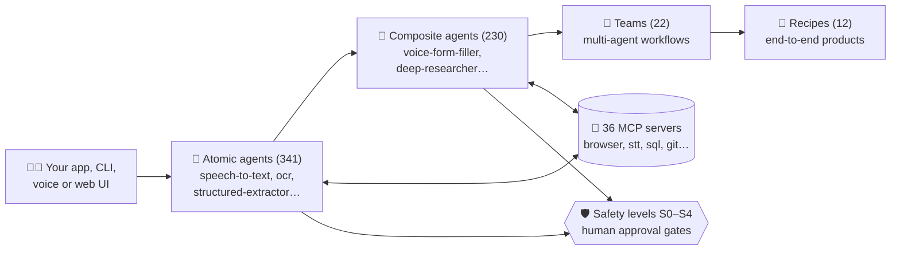

<div align="center">

# 🤖 Agents for Everything

### One agent for every real-world task. Snap them together to build anything.

An open-source, framework-agnostic library of **571 single-purpose AI agents** with typed contracts, safety levels and tests,<br/>
plus **22 multi-agent teams**, **12 runnable product recipes** and **36 MCP tool servers**.

[](CATALOG.md)
[](#-browse-all-8-families)
[](#-ready-made-teams)
[](#-product-recipes)
[](CATALOG.md#mcp-servers)

[](https://github.com/rupeshbharambe24/agents-for-everything/actions/workflows/validate.yml)
[](https://github.com/rupeshbharambe24/agents-for-everything/actions/workflows/evals.yml)
[](evals/leaderboard.md)
[](spec/SPEC.md)
[](LICENSE)
[](CONTRIBUTING.md)
[](https://github.com/rupeshbharambe24/agents-for-everything/stargazers)

**[🔎 Live explorer](https://rupeshbharambe24.github.io/agents-for-everything/)** ·
**[📖 Full catalog](CATALOG.md)** ·
**[🚀 Quick start](#-quick-start)** ·
**[🗺️ Blueprint](BLUEPRINT.md)** ·
**[🤝 Contribute](#-contributing)**

</div>

---

## ✨ Why Agents for Everything?

Building an AI product usually means writing the same agents again and again: a transcriber, an extractor, a form filler, a guardrail. This repo gives you each of those as a **ready, tested building block**.

| | |
|---|---|
| 🧱 **One agent, one job** | Every agent does a single task well: `speech-to-text`, `pii-redactor`, `invoice-receipt-parser`, `web-form-filler`… |
| 🔌 **Typed contracts** | Every agent declares JSON Schema input and output, so agents snap together without glue code. |
| 🛡️ **Safe by default** | Every agent has a safety level (S0–S4). Anything that sends, pays or deletes needs human approval. |
| 🧪 **Tested** | Every agent ships with eval cases and a rubric (6,492 unique cases in total; more depth is [welcome](CONTRIBUTING.md)). CI runs them on every change. |
| 🌍 **Model- and framework-agnostic** | Run on any model, including local open-weights models via Ollama. `afe export` produces Agent Skills, A2A cards, MCP servers, LangGraph graphs and coding-assistant subagents; [adapters](packages/adapters/README.md) for the OpenAI Agents SDK, Claude Agent SDK, Google ADK, CrewAI, Microsoft Agent Framework and Mastra are in progress. |
| 📦 **Take only what you need** | `afe add voice/speech-to-text` copies one agent (and what it depends on) into your project, shadcn/ui-style. |

---

## 🧱 How it fits together



---

## 🔎 Find agents for your use case

<details>
<summary><b>🎙️ Voice: fill forms, search and dictate by voice, in many languages</b></summary>

- **Ready-made:** [`voice/voice-form-filler`](agents/perception/voice/voice-form-filler/README.md) · [`voice/voice-search`](agents/perception/voice/voice-search/README.md) · [`voice/realtime-voice-assistant`](agents/perception/voice/realtime-voice-assistant/README.md)
- **Building blocks:** [`voice/speech-to-text`](agents/perception/voice/speech-to-text/README.md) → [`text/structured-extractor`](agents/information/text/structured-extractor/README.md) → [`orchestration/verifier`](agents/core/orchestration/verifier/README.md) → [`browser/web-form-filler`](agents/action/browser/web-form-filler/README.md) → [`orchestration/human-approval-gate`](agents/core/orchestration/human-approval-gate/README.md)
- **Recipe:** [`recipes/voice-form-filling`](recipes/voice-form-filling/README.md) (with a local web UI) · [`recipes/accessible-web`](recipes/accessible-web/README.md)

</details>

<details>
<summary><b>📚 Research: cited reports, document Q&A, fact checking</b></summary>

- **Agents:** [`research/deep-researcher`](agents/information/research/deep-researcher/README.md) · [`search/rag-qa`](agents/information/search/rag-qa/README.md) · [`search/answer-engine`](agents/information/search/answer-engine/README.md) · [`research/fact-checker`](agents/information/research/fact-checker/README.md) · [`guardrails/hallucination-checker`](agents/core/guardrails/hallucination-checker/README.md)
- **Teams:** [`research-team`](teams/research-team/README.md) · [`regulatory-watch`](teams/regulatory-watch/README.md)
- **Recipes:** [`deep-research-app`](recipes/deep-research-app/README.md) · [`chat-with-your-docs`](recipes/chat-with-your-docs/README.md)

</details>

<details>
<summary><b>🌐 Automation: browsers, desktops and shells, with approval gates</b></summary>

- **Browser:** [`browser/web-navigator`](agents/action/browser/web-navigator/README.md) · [`browser/web-form-filler`](agents/action/browser/web-form-filler/README.md) (never auto-submits) · [`browser/web-scraper`](agents/action/browser/web-scraper/README.md) (respects `robots.txt`) · [`browser/web-tester`](agents/action/browser/web-tester/README.md)
- **Computer use:** [`computer-use/shell-operator`](agents/action/computer-use/shell-operator/README.md) · [`computer-use/desktop-operator`](agents/action/computer-use/desktop-operator/README.md) · [`computer-use/app-automator`](agents/action/computer-use/app-automator/README.md)
- **Team → recipe:** [`web-qa-team`](teams/web-qa-team/README.md) → [`ai-qa-engineer`](recipes/ai-qa-engineer/README.md)

</details>

<details>
<summary><b>💻 Software, data and security: code, tests, SQL, incident response</b></summary>

- **Coding:** [`coding/code-generator`](agents/builders/coding/code-generator/README.md) · [`coding/bug-fixer`](agents/builders/coding/bug-fixer/README.md) · [`coding/test-writer`](agents/builders/coding/test-writer/README.md) · [`coding/code-reviewer`](agents/builders/coding/code-reviewer/README.md)
- **Data and ops:** [`data/text-to-sql`](agents/builders/data/text-to-sql/README.md) · [`data/data-analyst`](agents/builders/data/data-analyst/README.md) · [`devops/log-analyzer`](agents/builders/devops/log-analyzer/README.md) · [`devops/incident-responder`](agents/builders/devops/incident-responder/README.md)
- **Security:** [`security/secret-scanner`](agents/builders/security/secret-scanner/README.md) · [`security/vuln-triager`](agents/builders/security/vuln-triager/README.md) · [`security/phishing-analyzer`](agents/builders/security/phishing-analyzer/README.md)
- **Teams:** [`software-squad`](teams/software-squad/README.md) · [`bug-squash`](teams/bug-squash/README.md) · [`incident-war-room`](teams/incident-war-room/README.md) · [`data-insights`](teams/data-insights/README.md)

</details>

<details>
<summary><b>💼 Business: inbox, meetings, support, sales, finance</b></summary>

- **Productivity:** [`communication/inbox-triager`](agents/business/communication/inbox-triager/README.md) · [`meetings/meeting-notetaker`](agents/business/meetings/meeting-notetaker/README.md) · [`productivity/task-manager`](agents/life/productivity/task-manager/README.md)
- **Customer-facing:** [`support/support-chatbot`](agents/business/support/support-chatbot/README.md) · [`support/ticket-triager`](agents/business/support/ticket-triager/README.md) · [`sales/outreach-personalizer`](agents/business/sales/outreach-personalizer/README.md)
- **Back office:** [`documents/invoice-receipt-parser`](agents/action/documents/invoice-receipt-parser/README.md) · [`finance/accounts-payable`](agents/business/finance/accounts-payable/README.md) · [`legal/contract-analyzer`](agents/business/legal/contract-analyzer/README.md)
- **Teams:** [`inbox-zero`](teams/inbox-zero/README.md) · [`meeting-to-done`](teams/meeting-to-done/README.md) · [`support-desk`](teams/support-desk/README.md) · [`sdr-team`](teams/sdr-team/README.md)

</details>

<details>
<summary><b>🏦 Regulated industries: banking, insurance, healthcare, government, on-prem</b></summary>

- **12 industry packs, 91 agents:** [industry packs overview](agents/industries/README.md)
- **Highlights:** [`banking/kyc-onboarding`](agents/industries/banking/kyc-onboarding/README.md) · [`banking/aml-alert-investigator`](agents/industries/banking/aml-alert-investigator/README.md) · [`healthcare/medical-scribe`](agents/industries/healthcare/medical-scribe/README.md) · [`insurance/claims-intake`](agents/industries/insurance/claims-intake/README.md) · [`government/citizen-services-assistant`](agents/industries/government/citizen-services-assistant/README.md)
- **Run fully on-prem:** [`profiles/regulated-airgapped.yaml`](profiles/regulated-airgapped.yaml) · [local and on-prem guide](docs/guides/local-onprem.md)

</details>

---

## 🚀 Quick start

**Requirements:** Python 3.10+ and [uv](https://docs.astral.sh/uv/). No API keys needed: agents run in an offline, deterministic mode until you connect a model.

```bash
git clone https://github.com/rupeshbharambe24/agents-for-everything.git
cd agents-for-everything
uv sync --all-packages          # installs the core runtime and the `afe` CLI
```

```bash
uv run afe search "fill a form by voice"            # find agents
uv run afe info voice/voice-form-filler             # see contract, tools, safety level
uv run afe run text/summarizer --input '{"text": "Agents for Everything gives you composable agents. Each one does a single job."}'
uv run afe test voice/voice-form-filler             # run its eval cases
uv run afe graph research-team                      # show a team's workflow
uv run afe add voice/voice-form-filler --dest ../my-app/agents   # copy it into your project
```

<details>
<summary><b>🐍 Use it from Python</b></summary>

```python
from agents_for_everything import AgentRunner, RunContext

runner = AgentRunner()
result = runner.run(
    "text/summarizer",
    {"text": "Single-purpose agents compose through typed JSON schemas."},
    context=RunContext(provider_name="ollama", model="qwen2.5:14b"),  # or leave out for offline mode
)
print(result.output)
```

</details>

<details>
<summary><b>📦 Export agents to other ecosystems</b></summary>

```bash
uv run afe export voice/speech-to-text --as skill --out ./exports      # Agent Skill (SKILL.md)
uv run afe export voice/speech-to-text --as a2a --out ./exports        # A2A Agent Card
uv run afe export voice/speech-to-text --as mcp-server --out ./exports
uv run afe export --all --as subagent --out ./exports/subagents        # coding-assistant subagents
```

</details>

<details>
<summary><b>🖥️ Browse the catalog locally</b></summary>

```bash
python3 -m http.server 4173 --directory docs/site
# open http://127.0.0.1:4173 to search and filter all 571 agents
```

</details>

<details>
<summary><b>🟦 TypeScript (Node 22.6+)</b></summary>

```bash
node --test packages/core-typescript/tests/*.test.ts packages/adapters/tests/*.test.ts
```

</details>

---

## 📂 Browse all 8 families

| Family | Agents | Categories |
|---|---:|---|
| 🧭 **Core** | 46 | [Orchestration](agents/core/orchestration/README.md) · [Memory](agents/core/memory/README.md) · [Guardrails](agents/core/guardrails/README.md) · [Evaluation](agents/core/evaluation/README.md) |
| 🎙️ **Perception** | 59 | [Voice](agents/perception/voice/README.md) · [Audio](agents/perception/audio/README.md) · [Vision](agents/perception/vision/README.md) · [Video](agents/perception/video/README.md) · [Accessibility](agents/perception/accessibility/README.md) |
| 📚 **Information** | 47 | [Text](agents/information/text/README.md) · [Search](agents/information/search/README.md) · [Research](agents/information/research/README.md) |
| 🌐 **Action** | 53 | [Browser](agents/action/browser/README.md) · [Computer use](agents/action/computer-use/README.md) · [Documents](agents/action/documents/README.md) · [Integration](agents/action/integration/README.md) · [Physical](agents/action/physical/README.md) |
| 💻 **Builders** | 76 | [Coding](agents/builders/coding/README.md) · [DevOps](agents/builders/devops/README.md) · [Data](agents/builders/data/README.md) · [AI engineering](agents/builders/ai-engineering/README.md) · [Security](agents/builders/security/README.md) · [IT support](agents/builders/it-support/README.md) |
| 💼 **Business** | 134 | [Communication](agents/business/communication/README.md) · [Meetings](agents/business/meetings/README.md) · [Content](agents/business/content/README.md) · [Marketing](agents/business/marketing/README.md) · [Sales](agents/business/sales/README.md) · [Support](agents/business/support/README.md) · [Finance](agents/business/finance/README.md) · [Legal](agents/business/legal/README.md) · [HR](agents/business/hr/README.md) · [Operations](agents/business/operations/README.md) · [Supply chain](agents/business/supply-chain/README.md) · [Strategy](agents/business/strategy/README.md) |
| 🌿 **Life** | 65 | [Productivity](agents/life/productivity/README.md) · [Personal](agents/life/personal/README.md) · [Travel](agents/life/travel/README.md) · [Wellness](agents/life/wellness/README.md) · [Education](agents/life/education/README.md) · [Creative](agents/life/creative/README.md) · [Community](agents/life/community/README.md) |
| 🏢 **Industries** | 91 | [Banking](agents/industries/banking/README.md) · [Insurance](agents/industries/insurance/README.md) · [Healthcare](agents/industries/healthcare/README.md) · [E-commerce](agents/industries/ecommerce/README.md) · [Real estate](agents/industries/real-estate/README.md) · [Manufacturing](agents/industries/manufacturing/README.md) · [Agriculture](agents/industries/agriculture/README.md) · [Energy](agents/industries/energy/README.md) · [Government](agents/industries/government/README.md) · [Hospitality](agents/industries/hospitality/README.md) · [Science](agents/industries/science/README.md) · [Gaming](agents/industries/gaming/README.md) |
| **Total** | **571** | **54 categories** · 66 P0 · 170 P1 · 335 P2 |

<details>
<summary><b>See example agents in every category</b></summary>

| Category | Example agents |
|---|---|
| [Orchestration](agents/core/orchestration/README.md) (18) | router, task-planner, supervisor, critic, verifier, human-approval-gate, agent-builder |
| [Memory](agents/core/memory/README.md) (10) | memory-writer, memory-retriever, knowledge-ingestor, knowledge-graph-builder, session-summarizer |
| [Guardrails](agents/core/guardrails/README.md) (12) | prompt-injection-detector, pii-redactor, content-moderator, hallucination-checker, red-teamer |
| [Evaluation](agents/core/evaluation/README.md) (6) | llm-judge, test-case-generator, regression-runner, benchmark-runner, trace-analyzer |
| [Voice](agents/perception/voice/README.md) (17) | speech-to-text, text-to-speech, voice-form-filler, realtime-voice-assistant, live-interpreter |
| [Audio](agents/perception/audio/README.md) (8) | audio-cleaner, podcast-producer, audio-search, audiobook-producer, music-tagger |
| [Vision](agents/perception/vision/README.md) (17) | ocr, visual-qa, screenshot-understander, chart-reader, id-document-reader |
| [Video](agents/perception/video/README.md) (9) | video-summarizer, video-captioner, clip-generator, dubbing-agent, lecture-to-notes |
| [Accessibility](agents/perception/accessibility/README.md) (8) | alt-text-writer, accessibility-auditor, screen-narrator, live-captioner, easy-read-simplifier |
| [Text](agents/information/text/README.md) (17) | summarizer, translator, rewriter, classifier, structured-extractor, entity-extractor |
| [Search](agents/information/search/README.md) (15) | web-search, answer-engine, rag-qa, semantic-search, enterprise-search, news-monitor |
| [Research](agents/information/research/README.md) (15) | deep-researcher, source-reader, fact-checker, report-writer, competitive-analyst |
| [Browser](agents/action/browser/README.md) (12) | web-navigator, web-form-filler, web-scraper, page-change-monitor, web-tester |
| [Computer use](agents/action/computer-use/README.md) (9) | shell-operator, desktop-operator, app-automator, mobile-operator, macro-recorder |
| [Documents](agents/action/documents/README.md) (18) | document-parser, table-extractor, spreadsheet-agent, invoice-receipt-parser, file-organizer |
| [Integration](agents/action/integration/README.md) (8) | api-caller, workflow-builder, webhook-handler, mcp-server-generator, notification-dispatcher |
| [Physical](agents/action/physical/README.md) (6) | smart-home-controller, sensor-monitor, energy-optimizer, robot-task-planner, vehicle-diagnostics |
| [Coding](agents/builders/coding/README.md) (22) | code-generator, code-reviewer, bug-fixer, test-writer, codebase-qa, ci-fixer |
| [DevOps](agents/builders/devops/README.md) (13) | log-analyzer, incident-responder, alert-triager, iac-generator, cloud-cost-optimizer |
| [Data](agents/builders/data/README.md) (15) | text-to-sql, data-analyst, data-cleaner, chart-maker, anomaly-detector, forecaster |
| [AI engineering](agents/builders/ai-engineering/README.md) (8) | prompt-engineer, rag-builder, automl-trainer, model-evaluator, model-monitor |
| [Security](agents/builders/security/README.md) (12) | vuln-triager, secure-code-reviewer, secret-scanner, phishing-analyzer, sbom-auditor |
| [IT support](agents/builders/it-support/README.md) (6) | helpdesk-agent, access-request-handler, device-setup-guide, license-manager, asset-inventory |
| [Communication](agents/business/communication/README.md) (10) | inbox-triager, email-drafter, chat-summarizer, follow-up-tracker, newsletter-digest |
| [Meetings](agents/business/meetings/README.md) (8) | meeting-scheduler, meeting-notetaker, action-item-extractor, meeting-prep, meeting-follow-up |
| [Content](agents/business/content/README.md) (15) | blog-writer, copywriter, social-post-writer, content-repurposer, technical-writer, editor |
| [Marketing](agents/business/marketing/README.md) (14) | campaign-planner, ad-creative-generator, seo-auditor, keyword-researcher, brand-monitor |
| [Sales](agents/business/sales/README.md) (13) | lead-finder, lead-enricher, lead-scorer, account-researcher, outreach-personalizer, crm-updater |
| [Support](agents/business/support/README.md) (11) | support-chatbot, ticket-triager, reply-drafter, kb-writer, escalation-detector |
| [Finance](agents/business/finance/README.md) (14) | transaction-categorizer, accounts-payable, bank-reconciler, expense-auditor, financial-statement-analyzer |
| [Legal](agents/business/legal/README.md) (13) | contract-analyzer, nda-reviewer, compliance-monitor, terms-simplifier, contract-drafter |
| [HR](agents/business/hr/README.md) (12) | jd-writer, resume-screener, hr-policy-qa, onboarding-buddy, candidate-sourcer |
| [Operations](agents/business/operations/README.md) (10) | project-manager, status-reporter, sop-writer, requirements-analyst, okr-tracker |
| [Supply chain](agents/business/supply-chain/README.md) (8) | shipment-tracker, demand-forecaster, inventory-optimizer, route-optimizer, customs-doc-preparer |
| [Strategy](agents/business/strategy/README.md) (6) | strategy-analyst, decision-analyst, business-plan-writer, pitch-deck-builder, board-pack-preparer |
| [Productivity](agents/life/productivity/README.md) (10) | task-manager, daily-briefer, note-organizer, reminder-agent, personal-knowledge-qa |
| [Personal](agents/life/personal/README.md) (14) | personal-finance-tracker, bill-subscription-manager, shopping-assistant, meal-planner, event-planner |
| [Travel](agents/life/travel/README.md) (6) | trip-planner, flight-hotel-searcher, travel-doc-checker, local-guide, flight-tracker |
| [Wellness](agents/life/wellness/README.md) (8) | symptom-navigator, lab-report-explainer, medication-reminder, fitness-coach, sleep-coach |
| [Education](agents/life/education/README.md) (12) | tutor, quiz-generator, flashcard-maker, course-builder, language-partner, math-solver |
| [Creative](agents/life/creative/README.md) (10) | photo-organizer, brand-kit-designer, storyboard-artist, game-designer, 3d-asset-generator |
| [Community](agents/life/community/README.md) (5) | community-moderator, community-qa-bot, misinformation-flagger, event-organizer, volunteer-coordinator |
| [Banking](agents/industries/banking/README.md) (17) | kyc-onboarding, aml-alert-investigator, sanctions-screener, fraud-signal-explainer, regulatory-circular-tracker |
| [Insurance](agents/industries/insurance/README.md) (6) | claims-intake, claims-adjuster-assistant, underwriting-assistant, policy-explainer, policy-comparer |
| [Healthcare](agents/industries/healthcare/README.md) (8) | medical-scribe, patient-intake, clinical-coder, prior-authorization, clinical-trial-matcher |
| [E-commerce](agents/industries/ecommerce/README.md) (11) | product-listing-writer, catalog-enricher, shopping-concierge, pricing-monitor, marketplace-sync |
| [Real estate](agents/industries/real-estate/README.md) (7) | listing-writer, property-valuator, lease-abstractor, property-search-assistant, tenant-screening-assistant |
| [Manufacturing](agents/industries/manufacturing/README.md) (6) | quality-inspector, predictive-maintenance, maintenance-copilot, work-instruction-writer, production-scheduler |
| [Agriculture](agents/industries/agriculture/README.md) (6) | crop-doctor, farm-weather-advisor, market-price-advisor, soil-report-explainer, agri-scheme-finder |
| [Energy](agents/industries/energy/README.md) (5) | utility-bill-analyzer, solar-sizing-advisor, load-forecaster, outage-communicator, energy-auditor |
| [Government](agents/industries/government/README.md) (8) | citizen-services-assistant, scheme-eligibility-checker, gov-form-assistant, rti-drafter, tender-analyzer |
| [Hospitality](agents/industries/hospitality/README.md) (4) | reservation-agent, hotel-concierge, menu-engineer, housekeeping-optimizer |
| [Science](agents/industries/science/README.md) (9) | paper-reader, experiment-designer, lab-protocol-writer, proof-assistant, peer-review-assistant |
| [Gaming](agents/industries/gaming/README.md) (4) | npc-agent, game-tester, level-generator, game-master |

</details>

---

## 👥 Ready-made teams

Teams are reusable multi-agent workflows (`team.yaml`): which agents, in what order, with which approval points.

<details>
<summary><b>See all 22 teams</b></summary>

| Team | Pattern | Priority | What it does |
|---|---|:---:|---|
| [`research-team`](teams/research-team/README.md) | Orchestrator–workers | P0 | Cited, grounding-checked research reports |
| [`document-intake`](teams/document-intake/README.md) | Prompt chaining | P0 | Classify, parse, extract and approve documents |
| [`voice-concierge`](teams/voice-concierge/README.md) | Routing | P0 | Voice in → routed action → voice out |
| [`inbox-zero`](teams/inbox-zero/README.md) | Prompt chaining | P0 | Triage mail, draft replies, extract tasks |
| [`meeting-to-done`](teams/meeting-to-done/README.md) | Prompt chaining | P0 | Meeting notes → action items → tracked tasks |
| [`support-desk`](teams/support-desk/README.md) | Routing + handoff | P0 | Tiered customer support with escalation |
| [`software-squad`](teams/software-squad/README.md) | Evaluator–optimizer | P1 | Requirements → code → tests → review → PR |
| [`bug-squash`](teams/bug-squash/README.md) | Orchestrator–workers | P1 | Triage → fix → test → review |
| [`data-insights`](teams/data-insights/README.md) | Plan-and-execute | P1 | Question → SQL → analysis → chart → report |
| [`content-studio`](teams/content-studio/README.md) | Prompt chaining | P1 | Keywords → draft → edit → SEO → social posts |
| [`sdr-team`](teams/sdr-team/README.md) | Prompt chaining | P1 | Find, enrich and score leads, draft outreach |
| [`incident-war-room`](teams/incident-war-room/README.md) | Orchestrator–workers | P1 | Alerts → logs → approved fix → postmortem |
| [`accounts-payable-team`](teams/accounts-payable-team/README.md) | Prompt chaining | P1 | Invoice parsing → matching → approval |
| [`contract-desk`](teams/contract-desk/README.md) | Prompt chaining | P1 | Contract intake, clause review, obligations |
| [`kyc-pipeline`](teams/kyc-pipeline/README.md) | Prompt chaining | P1 | ID extraction → KYC → sanctions → audit |
| [`chief-of-staff`](teams/chief-of-staff/README.md) | Hierarchical | P1 | Daily brief, inbox, meeting prep, tasks, memory |
| [`web-qa-team`](teams/web-qa-team/README.md) | Orchestrator–workers | P1 | Navigate → test → accessibility audit → issues |
| [`agent-factory`](teams/agent-factory/README.md) | Evaluator–optimizer | P1 | Build new agents with evals and red-teaming |
| [`ecosystem-radar`](teams/ecosystem-radar/README.md) | Scheduled orchestrator | P1 | Track new agent standards, papers and tools |
| [`hiring-pipeline`](teams/hiring-pipeline/README.md) | Prompt chaining | P2 | JD → sourcing → screening → bias audit |
| [`learning-coach`](teams/learning-coach/README.md) | Hierarchical | P2 | Course → tutoring → quizzes → study plan |
| [`regulatory-watch`](teams/regulatory-watch/README.md) | Prompt chaining | P2 | Regulator updates → impact → brief |

</details>

## 🍳 Product recipes

Recipes are complete, runnable products built from agents and teams, each with a demo app and an integration test.

<details>
<summary><b>See all 12 recipes</b></summary>

| Recipe | Priority | What you get |
|---|:---:|---|
| [`voice-form-filling`](recipes/voice-form-filling/README.md) | P0 | Speak in any language → validated form fields → read-back → fill (with a local web UI) |
| [`chat-with-your-docs`](recipes/chat-with-your-docs/README.md) | P0 | Private document Q&A with PII redaction and grounding checks |
| [`deep-research-app`](recipes/deep-research-app/README.md) | P0 | Multi-source research app producing cited reports |
| [`invoice-automation`](recipes/invoice-automation/README.md) | P1 | Inbox → invoice extraction → matching → approval |
| [`ai-receptionist`](recipes/ai-receptionist/README.md) | P1 | AI-disclosed phone and chat receptionist with booking |
| [`personal-chief-of-staff`](recipes/personal-chief-of-staff/README.md) | P1 | Morning brief across inbox, meetings, tasks and memory |
| [`ai-qa-engineer`](recipes/ai-qa-engineer/README.md) | P1 | Point at a staging URL, get tests and bug reports |
| [`content-engine`](recipes/content-engine/README.md) | P1 | One recording → podcast, blog, social posts and clips |
| [`vernacular-banking-helpline`](recipes/vernacular-banking-helpline/README.md) | P2 | Local-language banking help, scam checks, grievances |
| [`regulatory-intelligence`](recipes/regulatory-intelligence/README.md) | P2 | Regulator updates mapped to controls and impact reports |
| [`farmer-advisory`](recipes/farmer-advisory/README.md) | P2 | Low-bandwidth photo and voice crop advice |
| [`accessible-web`](recipes/accessible-web/README.md) | P2 | Page narration, accessibility audit and voice form filling |

</details>

---

## 🛡️ Safety first

Every agent declares a safety level, and the runtime enforces it.

| Level | Meaning | Default control |
|:---:|---|---|
| 🟢 **S0** | Pure computation, no external access | Schema validation; no tools allowed |
| 🟢 **S1** | Reads external or private data | Read-only tools; prompt-injection screening |
| 🟡 **S2** | Reversible writes (drafts, unsubmitted forms) | Preview, undo, logged changes |
| 🟠 **S3** | External side effects (send, post, run commands) | Human approval per action |
| 🔴 **S4** | Money, legal, health, identity, deletion | Mandatory sign-off, audit log, no autonomous mode |

Agents move from `spec` → `prototype` → `beta` → `stable` as they gain eval cases, implementations and reviews. Some things we will never build (CAPTCHA solving, covert bots, autonomous trading and more): see [SECURITY.md](SECURITY.md).

---

## 🧰 Under the hood

- **[Spec](spec/SPEC.md)** (`afe/v1`, plus [`afe/v2`](spec/v2/SPEC.md)) and JSON Schemas for agents, teams, recipes and tools, with [shared types](spec/types) like `Transcript`, `Document` and `FormSchema`.
- **[36 MCP servers](CATALOG.md#mcp-servers)**: browser, filesystem, documents, OCR, STT, TTS, SQL, sandboxes, git, email, calendar and more.
- **[A2A registry](registry/a2a-index.json)**: every agent published as an Agent Card, with a [verified index](registry/verified-index.json).
- **[Deployment profiles](profiles/README.md)**: local, air-gapped and low-bandwidth setups with open-weights models.
- **[Shared eval datasets](evals/datasets/README.md)** including multilingual and Indic voice and form data, and an [eval leaderboard](evals/leaderboard.md).
- **[Architecture decisions](docs/adr)** and [guides](docs/guides): writing an agent, writing evals, safety review.

---

## 🗺️ Roadmap

- [x] Spec, schemas and shared types (`afe/v1`, `afe/v2` draft)
- [x] 571 agents with contracts, prompts, safety levels and offline eval suites
- [x] `afe` CLI, Python and TypeScript runtimes, exports (Skills, A2A, MCP, subagents)
- [x] 22 teams and 12 recipes with integration tests
- [ ] Live-model implementations and eval scores for every P0 agent
- [ ] More framework adapters tested end-to-end (LangGraph, OpenAI Agents SDK, Claude Agent SDK, Google ADK)
- [ ] Larger multilingual eval sets
- [ ] Community industry packs (telecom, pharma, construction, aviation…)

Full plan: [BLUEPRINT.md](BLUEPRINT.md#11-build-roadmap).

---

## 🤝 Contributing

**This project grows with its community, and every contribution counts.** You don't need to be an AI expert:

| You can… | Time | Start here |
|---|---|---|
| ⭐ **Star the repo** so more builders find it | 1 second | [Star](https://github.com/rupeshbharambe24/agents-for-everything/stargazers) |
| 🧪 **Add eval cases** to an agent (non-English ones are especially welcome) | 15 min | Any agent's `evals/cases.jsonl` |
| 🐛 **Report a bug or a confusing doc** | 5 min | [Open an issue](https://github.com/rupeshbharambe24/agents-for-everything/issues/new?template=bug.yml) |
| 💡 **Request an agent** for a task you need | 5 min | [Agent request](https://github.com/rupeshbharambe24/agents-for-everything/issues/new?template=agent-request.yml) |
| 🧩 **Build a new agent** | 1–2 h | `uv run afe new --tier atomic --category <category> --slug <name>` |
| 🔌 **Add a live-model implementation or framework adapter** | a few hours | [Writing an agent](docs/guides/writing-an-agent.md) |
| 🏢 **Propose an industry pack** | — | [New category RFC](https://github.com/rupeshbharambe24/agents-for-everything/issues/new?template=new-category-rfc.yml) |

Read the **[contributing guide](CONTRIBUTING.md)** to get set up in a few minutes. Look for [`good first issue`](https://github.com/rupeshbharambe24/agents-for-everything/labels/good%20first%20issue) labels.

### 💖 Contributors

<a href="https://github.com/rupeshbharambe24/agents-for-everything/graphs/contributors">
  
</a>

### 📈 Star history

<a href="https://star-history.com/#rupeshbharambe24/agents-for-everything&Date">
  
</a>

---

## ❓ FAQ

<details>
<summary><b>Is this a new agent framework?</b></summary>

No. It is a library of agents built on open standards (JSON Schema, MCP, A2A, Agent Skills). Use the small built-in runtime, or export agents to the framework you already use.

</details>

<details>
<summary><b>Do the agents call a real LLM?</b></summary>

Out of the box, agents run in an **offline, deterministic mode** so you can explore, test and run CI without API keys. Pass a provider and model (for example Ollama with an open-weights model) to run them with a real model. All offline eval cases pass, but they test contracts, safety gates and workflows, not model quality. Live-model scores are on the roadmap, and you can help produce them.

</details>

<details>
<summary><b>Can I use just one agent?</b></summary>

Yes. `afe add <category>/<agent>` copies that agent and the agents it depends on into your project. Nothing else is required.

</details>

<details>
<summary><b>Which models are supported?</b></summary>

Agents declare the capabilities they need (tool use, structured output, vision, audio), not a vendor. Frontier models and local open-weights models both work; see [deployment profiles](profiles/README.md).

</details>

<details>
<summary><b>Can I use it commercially?</b></summary>

Yes. Everything is under the [Apache-2.0 license](LICENSE).

</details>

---

<div align="center">

**If this saves you time, please ⭐ star the repo and share it. It helps more builders find it.**

Made with ❤️ by [@rupeshbharambe24](https://github.com/rupeshbharambe24) and [contributors](https://github.com/rupeshbharambe24/agents-for-everything/graphs/contributors) · [Apache-2.0](LICENSE)

</div>
