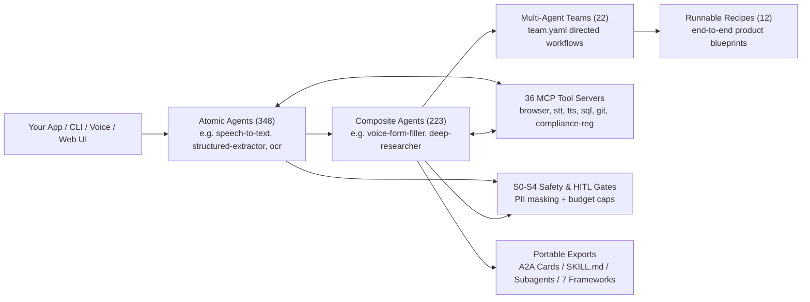

# Agents for Everything (`agents-for-everything`)

> **One agent for every real-world task. Snap them together like typed Lego blocks to build anything.**

[](CATALOG.md)
[](#browse-all-8-families--54-categories)
[](#22-ready-made-multi-agent-teams)
[](#12-end-to-end-product-recipes)
[](#mcp-servers-local-on-prem--multilingual-evals)
[](evals/leaderboard.md)
[](spec/SPEC.md)
[](LICENSE)

[**Full Catalog**](CATALOG.md) · [**Interactive Explorer**](docs/site/index.html) · [**Master Blueprint**](BLUEPRINT.md) · [**Eval Leaderboard**](evals/leaderboard.md) · [**Industry Packs**](agents/industries/README.md) · [**Local & On-Prem**](profiles/README.md) · [**Security Policy**](SECURITY.md)

---

`agents-for-everything` is an open-source, framework-agnostic, spec-first library of **571 single-purpose (atomic) and composite AI agents** across **54 categories**, **22 multi-agent teams**, **12 runnable product recipes**, and **36 MCP tool server contracts**. Every agent ships typed JSON Schema contracts (`afe://types/*`), explicit safety tiers (`S0`–`S4`), automated evals, local/on-prem open-weights support, and portable exports (`SKILL.md`, A2A Agent Cards, MCP wrappers, LangGraph, Claude/Codex subagents, CrewAI, Google ADK, OpenAI Agents SDK, Microsoft Agent Framework, and Mastra).

---

## Architecture at a Glance



---

## Quick Interactive Finder: What Do You Want to Build?

<details>
<summary><b>1. Voice-Powered Search, Dictation & Multilingual Form Filling</b> — speech in, validated structured JSON & filled forms out</summary>

- **Core agents:** [`voice/speech-to-text`](agents/perception/voice/speech-to-text/README.md) -> [`text/structured-extractor`](agents/information/text/structured-extractor/README.md) -> [`orchestration/verifier`](agents/core/orchestration/verifier/README.md) -> [`voice/text-to-speech`](agents/perception/voice/text-to-speech/README.md) -> [`browser/web-form-filler`](agents/action/browser/web-form-filler/README.md) -> [`orchestration/human-approval-gate`](agents/core/orchestration/human-approval-gate/README.md)
- **Ready-made composite & search:** [`voice/voice-form-filler`](agents/perception/voice/voice-form-filler/README.md), [`voice/voice-search`](agents/perception/voice/voice-search/README.md), [`voice/realtime-voice-assistant`](agents/perception/voice/realtime-voice-assistant/README.md)
- **Runnable recipe:** [`recipes/voice-form-filling`](recipes/voice-form-filling/README.md) & [`recipes/accessible-web`](recipes/accessible-web/README.md)
- **Shared Indic dataset:** [`evals/datasets/multilingual_form_utterances.jsonl`](evals/datasets/multilingual_form_utterances.jsonl) (`en-IN`, `hi-IN`, `mr-IN`, `ta-IN`, `te-IN`, `bn-IN`, `gu-IN`, `kn-IN`, `ml-IN`, `pa-IN`)

```bash
PYTHONPATH=.:packages/core-python/src:cli/src python3 -m afe_cli test voice/voice-form-filler
```

</details>

<details>
<summary><b>2. Cited Deep Research, Enterprise Search & Private Doc Q&A</b> — grounded answers with hallucination checks</summary>

- **Core agents:** [`search/web-search`](agents/information/search/web-search/README.md), [`search/rag-qa`](agents/information/search/rag-qa/README.md), [`research/deep-researcher`](agents/information/research/deep-researcher/README.md), [`research/fact-checker`](agents/information/research/fact-checker/README.md), [`guardrails/hallucination-checker`](agents/core/guardrails/hallucination-checker/README.md)
- **Ready-made teams:** [`teams/research-team`](teams/research-team/README.md), [`teams/regulatory-watch`](teams/regulatory-watch/README.md)
- **Runnable recipes:** [`recipes/deep-research-app`](recipes/deep-research-app/README.md), [`recipes/chat-with-your-docs`](recipes/chat-with-your-docs/README.md)

```bash
PYTHONPATH=.:packages/core-python/src:cli/src python3 -m afe_cli graph research-team
```

</details>

<details>
<summary><b>3. Browser, Desktop & Safe Shell Automation</b> — Playwright navigation, non-submitting forms, and sandboxed commands</summary>

- **Browser:** [`browser/web-navigator`](agents/action/browser/web-navigator/README.md) (`S3`), [`browser/web-form-filler`](agents/action/browser/web-form-filler/README.md) (`S2`, never auto-submits), [`browser/web-scraper`](agents/action/browser/web-scraper/README.md) (`S1`, respects `robots.txt`), [`browser/web-tester`](agents/action/browser/web-tester/README.md)
- **OS / Shell:** [`computer-use/shell-operator`](agents/action/computer-use/shell-operator/README.md), [`computer-use/desktop-operator`](agents/action/computer-use/desktop-operator/README.md), [`computer-use/app-automator`](agents/action/computer-use/app-automator/README.md)
- **QA workflow:** [`teams/web-qa-team`](teams/web-qa-team/README.md) -> [`recipes/ai-qa-engineer`](recipes/ai-qa-engineer/README.md)

</details>

<details>
<summary><b>4. Software Engineering, DevOps, Data & Security</b> — code generation, tests, PR review, SQL & CVE triage</summary>

- **Coding & DevOps:** [`coding/code-generator`](agents/builders/coding/code-generator/README.md), [`coding/bug-fixer`](agents/builders/coding/bug-fixer/README.md), [`coding/test-writer`](agents/builders/coding/test-writer/README.md), [`devops/log-analyzer`](agents/builders/devops/log-analyzer/README.md), [`devops/incident-responder`](agents/builders/devops/incident-responder/README.md)
- **Data & Security:** [`data/text-to-sql`](agents/builders/data/text-to-sql/README.md), [`data/data-analyst`](agents/builders/data/data-analyst/README.md), [`security/secret-scanner`](agents/builders/security/secret-scanner/README.md), [`security/vuln-triager`](agents/builders/security/vuln-triager/README.md)
- **Ready-made teams:** [`teams/software-squad`](teams/software-squad/README.md), [`teams/bug-squash`](teams/bug-squash/README.md), [`teams/incident-war-room`](teams/incident-war-room/README.md), [`teams/data-insights`](teams/data-insights/README.md)

</details>

<details>
<summary><b>5. Regulated Industries, Local On-Prem & Vernacular India Packs</b> — Banking, Healthcare, Gov, Agriculture & Legal</summary>

- **Industry directory:** [All 12 Industry Packs (`agents/industries/`)](agents/industries/README.md) — **91 vertical agents** reusing horizontal voice, document, and guardrail building blocks.
- **Vernacular & low-bandwidth recipes:** [`recipes/vernacular-banking-helpline`](recipes/vernacular-banking-helpline/README.md), [`recipes/farmer-advisory`](recipes/farmer-advisory/README.md), [`recipes/regulatory-intelligence`](recipes/regulatory-intelligence/README.md)
- **On-prem deployment:** [`profiles/regulated-airgapped.yaml`](profiles/regulated-airgapped.yaml) & [Local/On-Prem Guide](docs/guides/local-onprem.md) (`ollama` / local `llama3.3:70b` / `qwen2.5:14b`)

</details>

---

## Try It in 30 Seconds

<details open>
<summary><b>Option A — CLI (Zero API Keys Required: Offline Deterministic Mode)</b></summary>

```bash
# 1. Validate all 571 agents, 22 teams, 12 recipes, 36 MCP servers & links
PYTHONPATH=.:packages/core-python/src:cli/src python3 -m afe_cli validate

# 2. Search across categories & safety tiers
PYTHONPATH=.:packages/core-python/src:cli/src python3 -m afe_cli search "kyc" --safety S4

# 3. Inspect any agent & inspect team workflow schema compatibility
PYTHONPATH=.:packages/core-python/src:cli/src python3 -m afe_cli info voice/voice-form-filler
PYTHONPATH=.:packages/core-python/src:cli/src python3 -m afe_cli graph hiring-pipeline

# 4. Run an agent locally or copy it shadcn/ui-style into your own repo
PYTHONPATH=.:packages/core-python/src:cli/src python3 -m afe_cli run text/summarizer \
  --input '{"text":"Agents for Everything provides composable single-purpose AI agents."}'
PYTHONPATH=.:packages/core-python/src:cli/src python3 -m afe_cli add voice/voice-form-filler --dest ./my-app/agents
```

</details>

<details>
<summary><b>Option B — Python SDK (`uv sync` / `pip`) & Local Ollama</b></summary>

```python
from agents_for_everything import AgentRunner, RunContext

runner = AgentRunner()
result = runner.run(
    "text/summarizer",
    {"text": "Single-purpose agents compose via typed JSON schemas."},
    context=RunContext(provider_name="ollama", model="qwen2.5:14b"),  # or "auto"
)
print(result.output)
```

</details>

<details>
<summary><b>Option C — TypeScript / Node.js (`v22.6+` / `v26+`) & Adapters</b></summary>

```bash
node --test packages/core-typescript/tests/*.test.ts packages/adapters/tests/*.test.ts
```

</details>

<details>
<summary><b>Option D — Export Agents Anywhere (`SKILL.md`, A2A Card, MCP, Codex `.toml`, LangGraph)</b></summary>

```bash
PYTHONPATH=.:packages/core-python/src:cli/src python3 -m afe_cli export voice/speech-to-text --as a2a --out ./exports
PYTHONPATH=.:packages/core-python/src:cli/src python3 -m afe_cli export voice/speech-to-text --as skill --out ./exports
PYTHONPATH=.:packages/core-python/src:cli/src python3 -m afe_cli export --all --as subagent --out ./exports/subagents
```

</details>

<details>
<summary><b>Option E — Launch the Local Interactive Catalog & Compatibility Graph Explorer</b></summary>

```bash
python3 -m http.server 4173 --directory docs/site
# Open http://127.0.0.1:4173 in your browser to search 571 agents, filter P0/P1/P2 & S0-S4,
# inspect teams/recipes/MCP servers, and click through schema compatibility edges.
```

</details>

---

## Browse All 8 Families & 54 Categories

| Family | Agents | Categories | Explore |
|---|---:|---:|---|
| **1. Core** | **46** | 4 | Orchestration, Memory, Guardrails, Evaluation |
| **2. Perception** | **59** | 5 | Voice, Audio, Vision, Video, Accessibility |
| **3. Information** | **47** | 3 | Text, Search, Research |
| **4. Action** | **53** | 5 | Browser, Computer Use, Documents, Integration, Physical |
| **5. Builders** | **76** | 6 | Coding, DevOps, Data, AI Engineering, Security, IT Support |
| **6. Business** | **134** | 12 | Communication, Meetings, Content, Marketing, Sales, Support, Finance, Legal, HR, Operations, Supply Chain, Strategy |
| **7. Life** | **65** | 7 | Productivity, Personal, Travel, Wellness, Education, Creative, Community |
| **8. Industries** | **91** | 12 | Banking, Insurance, Healthcare, E-Commerce, Real Estate, Manufacturing, Agriculture, Energy, Government, Hospitality, Science, Gaming |
| **Total** | **571** | **54** | **66 P0 (`beta`) · 170 P1 (`prototype`) · 335 P2 (`prototype`)** |

Click any family below to jump straight to every category README:

<details>
<summary><b>Family 1 — Core (46 agents across 4 categories)</b></summary>

- [`core/orchestration`](agents/core/orchestration/README.md) (18) — router, task-planner, supervisor, critic, verifier, human-approval-gate, debate-moderator, model-selector, prompt-optimizer, and more
- [`core/memory`](agents/core/memory/README.md) (10) — memory-writer, memory-retriever, knowledge-ingestor, entity-resolver, wiki-maintainer, episodic-replay, and more
- [`core/guardrails`](agents/core/guardrails/README.md) (12) — prompt-injection-detector, pii-redactor, content-moderator, hallucination-checker, bias-auditor, data-residency-guard, age-safety-filter, and more
- [`core/evaluation`](agents/core/evaluation/README.md) (6) — llm-judge, test-case-generator, regression-runner, benchmark-runner, dataset-curator, ab-evaluator

</details>

<details>
<summary><b>Family 2 — Perception & Interaction (59 agents across 5 categories)</b></summary>

- [`perception/voice`](agents/perception/voice/README.md) (17) — speech-to-text, text-to-speech, voice-form-filler, voice-command, realtime-voice-assistant, voice-search, live-interpreter, ivr-designer, and more
- [`perception/audio`](agents/perception/audio/README.md) (8) — audio-cleaner, podcast-producer, audiobook-producer, audio-search, meeting-diarizer, music-tagger, sound-effect-generator
- [`perception/vision`](agents/perception/vision/README.md) (17) — ocr, visual-qa, screenshot-understander, diagram-to-code, document-layout-parser, scene-safety-monitor, id-document-reader, and more
- [`perception/video`](agents/perception/video/README.md) (9) — video-summarizer, clip-generator, video-captioner, dubbing-agent, lecture-to-notes, video-search, live-stream-monitor
- [`perception/accessibility`](agents/perception/accessibility/README.md) (8) — screen-narrator, live-captioner, alt-text-writer, accessibility-auditor, easy-read-simplifier, document-remediator, voice-control-navigator

</details>

<details>
<summary><b>Family 3 — Information (47 agents across 3 categories)</b></summary>

- [`information/text`](agents/information/text/README.md) (17) — summarizer, translator, rewriter, proofreader, classifier, structured-extractor, entity-extractor, regex-builder, readability-scorer, and more
- [`information/search`](agents/information/search/README.md) (15) — web-search, answer-engine, rag-qa, semantic-search, multimodal-search, patent-search, citation-finder, alert-digest, and more
- [`information/research`](agents/information/research/README.md) (15) — deep-researcher, source-reader, fact-checker, report-writer, competitive-analyst, due-diligence, policy-analyst, trend-spotter, and more

</details>

<details>
<summary><b>Family 4 — Action (53 agents across 5 categories)</b></summary>

- [`action/browser`](agents/action/browser/README.md) (12) — web-navigator, web-form-filler, web-scraper, booking-agent, checkout-assistant, secure-login-helper, web-to-api, and more
- [`action/computer-use`](agents/action/computer-use/README.md) (9) — shell-operator, desktop-operator, app-automator, mobile-operator, rpa-bridge, macro-recorder, window-organizer, and more
- [`action/documents`](agents/action/documents/README.md) (18) — document-parser, table-extractor, spreadsheet-agent, invoice-receipt-parser, file-organizer, contract-redliner, mail-merge-agent, and more
- [`action/integration`](agents/action/integration/README.md) (8) — api-caller, webhook-handler, workflow-builder, mcp-server-generator, etl-mapper, cron-scheduler, notification-dispatcher
- [`action/physical`](agents/action/physical/README.md) (6) — smart-home-controller, drone-mission-planner, robot-task-planner, energy-manager, warehouse-picker, vehicle-diagnostics

</details>

<details>
<summary><b>Family 5 — Builders (76 agents across 6 categories)</b></summary>

- [`builders/coding`](agents/builders/coding/README.md) (22) — code-generator, code-reviewer, bug-fixer, test-writer, codebase-qa, architect-agent, db-migration-writer, release-manager, and more
- [`builders/devops`](agents/builders/devops/README.md) (13) — log-analyzer, incident-responder, iac-generator, cloud-cost-optimizer, k8s-troubleshooter, slo-watcher, capacity-planner, and more
- [`builders/data`](agents/builders/data/README.md) (15) — text-to-sql, data-analyst, data-cleaner, etl-pipeline-builder, synthetic-data-generator, cohort-analyzer, a-b-test-analyst, and more
- [`builders/ai-engineering`](agents/builders/ai-engineering/README.md) (8) — prompt-engineer, rag-builder, fine-tune-preparer, embedding-selector, model-router-designer, agent-telemetry-analyst
- [`builders/security`](agents/builders/security/README.md) (12) — vuln-triager, secret-scanner, phishing-analyzer, secure-code-reviewer, sbom-auditor, soc-tier1-analyst, iam-policy-reviewer, and more
- [`builders/it-support`](agents/builders/it-support/README.md) (6) — helpdesk-agent, password-access-assistant, onboarding-provisioner, asset-manager, license-auditor, outage-communicator

</details>

<details>
<summary><b>Family 6 — Business Functions (134 agents across 12 categories)</b></summary>

- [`business/communication`](agents/business/communication/README.md) (10) · [`business/meetings`](agents/business/meetings/README.md) (8) · [`business/content`](agents/business/content/README.md) (15)
- [`business/marketing`](agents/business/marketing/README.md) (14) · [`business/sales`](agents/business/sales/README.md) (13) · [`business/support`](agents/business/support/README.md) (11)
- [`business/finance`](agents/business/finance/README.md) (14) · [`business/legal`](agents/business/legal/README.md) (13) · [`business/hr`](agents/business/hr/README.md) (12)
- [`business/operations`](agents/business/operations/README.md) (10) · [`business/supply-chain`](agents/business/supply-chain/README.md) (8) · [`business/strategy`](agents/business/strategy/README.md) (6)

</details>

<details>
<summary><b>Family 7 — Life & Learning (65 agents across 7 categories)</b></summary>

- [`life/productivity`](agents/life/productivity/README.md) (10) · [`life/personal`](agents/life/personal/README.md) (14) · [`life/travel`](agents/life/travel/README.md) (6)
- [`life/wellness`](agents/life/wellness/README.md) (8) · [`life/education`](agents/life/education/README.md) (12) · [`life/creative`](agents/life/creative/README.md) (10) · [`life/community`](agents/life/community/README.md) (5)

</details>

<details>
<summary><b>Family 8 — Industry Vertical Packs (91 agents across 12 packs)</b></summary>

See [**Industry Packs Overview (`agents/industries/README.md`)**](agents/industries/README.md) for horizontal reuse matrices & local/on-prem compliance rules:
- [`industries/banking`](agents/industries/banking/README.md) (17) · [`industries/insurance`](agents/industries/insurance/README.md) (6) · [`industries/healthcare`](agents/industries/healthcare/README.md) (8)
- [`industries/ecommerce`](agents/industries/ecommerce/README.md) (11) · [`industries/real-estate`](agents/industries/real-estate/README.md) (7) · [`industries/manufacturing`](agents/industries/manufacturing/README.md) (6)
- [`industries/agriculture`](agents/industries/agriculture/README.md) (6) · [`industries/energy`](agents/industries/energy/README.md) (5) · [`industries/government`](agents/industries/government/README.md) (8)
- [`industries/hospitality`](agents/industries/hospitality/README.md) (4) · [`industries/science`](agents/industries/science/README.md) (9) · [`industries/gaming`](agents/industries/gaming/README.md) (4)

</details>

---

## 22 Ready-Made Multi-Agent Teams

<details>
<summary><b>View all 22 reusable <code>team.yaml</code> workflow graphs</b></summary>

| Team | Pattern | Priority | Focus |
|---|---|---|---|
| [`research-team`](teams/research-team/README.md) | Orchestrator-workers | P0 | Cited, grounding-verified reports |
| [`document-intake`](teams/document-intake/README.md) | Prompt chaining | P0 | Classify, parse, extract & approve docs |
| [`voice-concierge`](teams/voice-concierge/README.md) | Routing | P0 | Voice in -> routed actions -> voice out |
| [`inbox-zero`](teams/inbox-zero/README.md) | Prompt chaining | P0 | Triage mail, draft replies & tasks |
| [`meeting-to-done`](teams/meeting-to-done/README.md) | Prompt chaining | P0 | Meeting notes -> actions -> tracked tasks |
| [`support-desk`](teams/support-desk/README.md) | Routing + handoff | P0 | Tiered customer support & escalations |
| [`software-squad`](teams/software-squad/README.md) | Evaluator-optimizer | P1 | Requirements -> code -> tests -> PR |
| [`bug-squash`](teams/bug-squash/README.md) | Orchestrator-workers | P1 | Triage -> fix -> tests -> review |
| [`data-insights`](teams/data-insights/README.md) | Plan-and-execute | P1 | SQL -> analysis -> chart -> report |
| [`content-studio`](teams/content-studio/README.md) | Prompt chaining | P1 | Research -> draft -> edit -> multi-channel |
| [`sdr-team`](teams/sdr-team/README.md) | Prompt chaining | P1 | Lead finding -> scoring -> staged outreach |
| [`incident-war-room`](teams/incident-war-room/README.md) | Orchestrator-workers | P1 | Alerts -> logs -> runbook gate -> postmortem |
| [`accounts-payable-team`](teams/accounts-payable-team/README.md) | Prompt chaining | P1 | Invoice parsing -> PO match -> S4 signoff |
| [`contract-desk`](teams/contract-desk/README.md) | Prompt chaining | P1 | Legal intake -> clauses -> NDA review |
| [`kyc-pipeline`](teams/kyc-pipeline/README.md) | Prompt chaining | P1 | ID extract -> KYC -> sanctions -> audit |
| [`chief-of-staff`](teams/chief-of-staff/README.md) | Hierarchical | P1 | Daily brief + inbox + prep + tasks + memory |
| [`web-qa-team`](teams/web-qa-team/README.md) | Orchestrator-workers | P1 | Navigate -> E2E test -> WCAG -> issues |
| [`agent-factory`](teams/agent-factory/README.md) | Evaluator-optimizer | P1 | Build agents, generate evals, red-team & judge |
| [`ecosystem-radar`](teams/ecosystem-radar/README.md) | Scheduled orchestrator | P1 | Track MCP/A2A/arXiv updates & digests |
| [`hiring-pipeline`](teams/hiring-pipeline/README.md) | Prompt chaining | P2 | JD -> source -> screen -> bias-audit -> HITL |
| [`learning-coach`](teams/learning-coach/README.md) | Hierarchical | P2 | Course -> tutor -> quizzes -> flashcards -> plan |
| [`regulatory-watch`](teams/regulatory-watch/README.md) | Prompt chaining | P2 | Circulars -> compliance -> policy -> brief |

</details>

---

## 12 End-to-End Product Recipes

<details>
<summary><b>View all 12 runnable product recipes (tested end-to-end)</b></summary>

| Recipe | Priority | Summary |
|---|---|---|
| [`voice-form-filling`](recipes/voice-form-filling/README.md) | P0 | Multilingual voice in -> extracted JSON -> read-back confirm -> form fill |
| [`chat-with-your-docs`](recipes/chat-with-your-docs/README.md) | P0 | Private doc ingestion, PII redaction, RAG & hallucination check |
| [`deep-research-app`](recipes/deep-research-app/README.md) | P0 | Multi-source research app producing grounded cited reports |
| [`invoice-automation`](recipes/invoice-automation/README.md) | P1 | Inbox -> invoice parser -> AP 3-way match -> S4 payment approval |
| [`ai-receptionist`](recipes/ai-receptionist/README.md) | P1 | AI-disclosed phone/messaging FAQ & appointment scheduling |
| [`personal-chief-of-staff`](recipes/personal-chief-of-staff/README.md) | P1 | Morning brief across inbox, meetings, tasks & long-term memory |
| [`ai-qa-engineer`](recipes/ai-qa-engineer/README.md) | P1 | Automated staging URL walkthrough, injection screen & bug reports |
| [`content-engine`](recipes/content-engine/README.md) | P1 | One audio/video recording -> podcast, blog, social posts & clips |
| [`vernacular-banking-helpline`](recipes/vernacular-banking-helpline/README.md) | P2 | Local-language banking voice help, scam check & gated grievance |
| [`regulatory-intelligence`](recipes/regulatory-intelligence/README.md) | P2 | Regulator circular monitoring mapped to controls & impact reports |
| [`farmer-advisory`](recipes/farmer-advisory/README.md) | P2 | Low-bandwidth photo/voice crop diagnosis, weather & mandi prices |
| [`accessible-web`](recipes/accessible-web/README.md) | P2 | Page narration, WCAG audit & voice-guided web form filling |

</details>

---

## MCP Servers, Local On-Prem & Multilingual Evals

- **36 Shared MCP Server Contracts (`mcp-servers/`):** Listed in [`CATALOG.md`](CATALOG.md#mcp-servers) (covering web, browser, filesystem, documents, OCR, STT, TTS, SQL, Python/shell sandboxes, git, ERP, payments, medical-kb, logistics, compliance-reg, telephony, threat-intel, home-automation, and more).
- **Local / On-Premises & Air-Gapped Profiles (`profiles/`):** [`local-onprem.yaml`](profiles/local-onprem.yaml), [`regulated-airgapped.yaml`](profiles/regulated-airgapped.yaml), and [`low-bandwidth-edge.yaml`](profiles/low-bandwidth-edge.yaml) ([Guide](docs/guides/local-onprem.md)).
- **Shared Indic Multilingual & Safety Datasets (`evals/datasets/`):** [`multilingual_form_utterances.jsonl`](evals/datasets/multilingual_form_utterances.jsonl), [`indic_voice_queries.jsonl`](evals/datasets/indic_voice_queries.jsonl), and [`regulated_safety_prompts.jsonl`](evals/datasets/regulated_safety_prompts.jsonl).

---

## Safety & Maturity Model

| Safety Level | Scope | Default Control |
|---|---|---|
| **S0** | Pure computation, zero external I/O | Strict JSON Schema validation (`tools: []` enforced at runtime) |
| **S1** | Read-only external/private data | Scoped read permissions + prompt-injection screening |
| **S2** | Reversible local writes / unsubmitted drafts | Diff/preview, undo capability, PII-masked action trace |
| **S3** | External side effects (send, post, write APIs, shell) | Human approval gate (`ApprovalRequiredError`) + `SAFETY_REVIEW.md` |
| **S4** | Money, legal, clinical, identity, irreversible deletion | Mandatory human sign-off, immutable audit log, domain disclaimers |

Maturity lifecycle: `spec` -> `prototype` (>= 10 passing eval cases) -> `beta` (>= 50 cases + Python/TS adapters + S3/S4 safety review) -> `stable` (recipe-proven production release). Read [`SECURITY.md`](SECURITY.md) for strict prohibited uses.

---

## Contributing & Ecosystem Radar

We welcome new atomic/composite agents, domain packs, multilingual eval cases, and framework adapters under **Apache-2.0** and DCO sign-off (`git commit -s`). Start with [`CONTRIBUTING.md`](CONTRIBUTING.md), [`docs/guides/writing-an-agent.md`](docs/guides/writing-an-agent.md), and [`AGENTS.md`](AGENTS.md). Stay current with protocol shifts (MCP, A2A, Agent Skills, AG-UI, OpenTelemetry GenAI) in [`radar/`](radar/2026-11.md).
