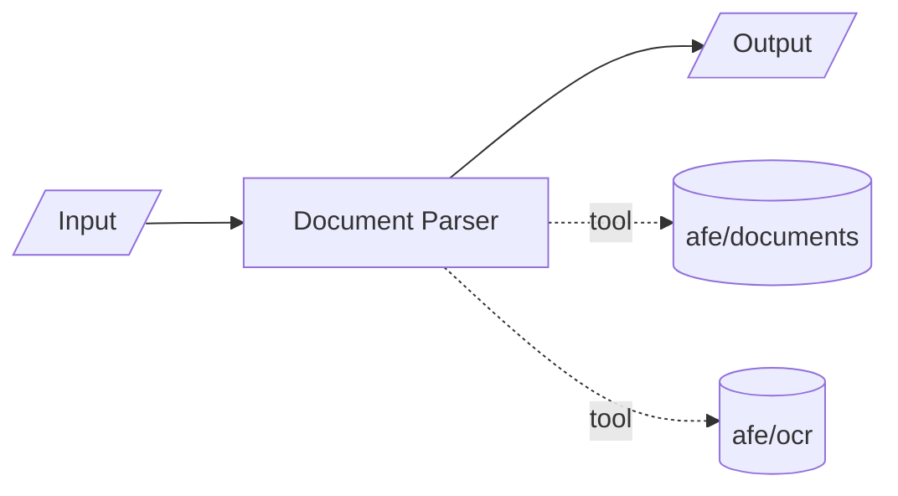

<!-- afe:begin-generated (scripts/build_readmes.py) — edit the manifest, not this block -->

[🏠 Agents for Everything](../../../../README.md) › [📖 Catalog](../../../../CATALOG.md) › [📄 Files and documents](../README.md) › **Document Parser**

# 📄 Document Parser

      

> Converts rich documents and scans into clean Markdown with preserved headings and sections.

Normalizes PDF/DOCX/HTML/scan inputs into clean Markdown and structured metadata.

| | |
|---|---|
| **Use it when** | Preparing uploaded files for Q&A, extraction, or summarization. |
| **Don't use it when** | Already-clean Markdown strings. |
| **Pattern** | `augmented-llm` |
| **Modality** | text |
| **Runtime** | interactive · memory: `none` |
| **Languages** | `en` |
| **Tags** | `documents` `document-parser` |

## 🚀 Quick start

```bash
afe add documents/document-parser          # copy this agent (and the agents it uses) into ./agents
afe info documents/document-parser         # manifest, tools, safety level
afe test documents/document-parser         # run its 50 eval cases
```

```python
from agents_for_everything import AgentRunner

payload = {"document": {"title": "Doc 1", "content": "# Heading 1\nBody content for document 1."}}  # from evals/cases.jsonl
result = AgentRunner().run("documents/document-parser", payload)
print(result.output)
```

> No `afe` command yet? See [Install the CLI](../../../../README.md#-quick-start).

## 🧩 How it works



1. The input is validated against [`input.schema.json`](schemas/input.schema.json).
2. The runtime enforces safety level **S1** and allows only the tools declared in [`tools.yaml`](tools.yaml).
3. The agent follows its [system prompt](prompts/system.md) using the `augmented-llm` pattern.
4. The output is validated against [`output.schema.json`](schemas/output.schema.json) before it is returned.

## 📥 Input

| Field | Type | Required | Notes |
|---|---|:---:|---|
| `document` | [`Document`](../../../../spec/types/Document.schema.json) | ✅ |  |

## 📤 Output

| Field | Type | Required | Notes |
|---|---|:---:|---|
| `markdown` | `string` | ✅ |  |
| `sections` | array of `string` | ✅ |  |
| `char_count` | `integer` | ✅ |  |

## 🔗 Composes with

- **Uses:** _none (atomic building block)_
- **Used by agents:** [`banking/banking-voice-assistant`](../../../industries/banking/banking-voice-assistant/README.md), [`banking/cashflow-lending-analyst`](../../../industries/banking/cashflow-lending-analyst/README.md), [`banking/collections-assistant`](../../../industries/banking/collections-assistant/README.md), [`banking/credit-memo-drafter`](../../../industries/banking/credit-memo-drafter/README.md), [`banking/dispute-chargeback-handler`](../../../industries/banking/dispute-chargeback-handler/README.md), [`banking/grievance-redressal`](../../../industries/banking/grievance-redressal/README.md), [`banking/loan-application-assistant`](../../../industries/banking/loan-application-assistant/README.md), [`banking/model-risk-validator`](../../../industries/banking/model-risk-validator/README.md), [`banking/regulatory-return-preparer`](../../../industries/banking/regulatory-return-preparer/README.md), [`energy/energy-auditor`](../../../industries/energy/energy-auditor/README.md), [`finance/financial-statement-analyzer`](../../../business/finance/financial-statement-analyzer/README.md), [`hr/candidate-sourcer`](../../../business/hr/candidate-sourcer/README.md), [`hr/interview-scheduler`](../../../business/hr/interview-scheduler/README.md), [`insurance/claims-adjuster-assistant`](../../../industries/insurance/claims-adjuster-assistant/README.md), [`insurance/claims-intake`](../../../industries/insurance/claims-intake/README.md), [`insurance/underwriting-assistant`](../../../industries/insurance/underwriting-assistant/README.md), [`legal/contract-analyzer`](../../../business/legal/contract-analyzer/README.md), [`real-estate/maintenance-request-agent`](../../../industries/real-estate/maintenance-request-agent/README.md), [`real-estate/property-search-assistant`](../../../industries/real-estate/property-search-assistant/README.md), [`real-estate/property-valuator`](../../../industries/real-estate/property-valuator/README.md), [`real-estate/tenant-screening-assistant`](../../../industries/real-estate/tenant-screening-assistant/README.md), [`science/materials-literature-miner`](../../../industries/science/materials-literature-miner/README.md), [`science/proof-assistant`](../../../industries/science/proof-assistant/README.md), [`science/results-to-manuscript`](../../../industries/science/results-to-manuscript/README.md), [`science/simulation-setup`](../../../industries/science/simulation-setup/README.md), [`supply-chain/purchase-order-agent`](../../../business/supply-chain/purchase-order-agent/README.md), [`supply-chain/supplier-sourcer`](../../../business/supply-chain/supplier-sourcer/README.md), [`wellness/health-record-organizer`](../../../life/wellness/health-record-organizer/README.md), [`wellness/nutrition-coach`](../../../life/wellness/nutrition-coach/README.md), [`wellness/symptom-navigator`](../../../life/wellness/symptom-navigator/README.md), [`wellness/wellbeing-companion`](../../../life/wellness/wellbeing-companion/README.md)
- **In teams:** [`document-intake`](../../../../teams/document-intake/README.md)

## 🧰 Tools (MCP servers)

| Server | Required | What it provides |
|---|:---:|---|
| [`afe/documents`](../../../../mcp-servers/documents/README.md) | ✅ | Parse PDF, DOCX, PPTX, HTML, and spreadsheets into structured Markdown/tables. |
| [`afe/ocr`](../../../../mcp-servers/ocr/README.md) | ✅ | Printed and handwritten text extraction with layout bounding boxes. |

## 🛡️ Safety and limits

| | |
|---|---|
| **Safety level** | **S1** — Reads data: Read-only tool scopes; untrusted input screened for prompt injection |
| **Autonomy** | **L1** — human executes |
| **Side effects** | none |
| **Needs approval for** | nothing |
| **Handles personal data** | no · retention: `none` |
| **Run limits** | 10 steps · 60 s · $0.03 max |

Full policy: [SECURITY.md](../../../../SECURITY.md).

## 📏 Evaluation

- **50 test cases** in [`evals/cases.jsonl`](evals/cases.jsonl), judged with [`evals/rubric.md`](evals/rubric.md).
- **Targets:** pass_rate ≥ 0.9 ([`eval.yaml`](evals/eval.yaml)).
- **Run:** `afe test documents/document-parser`

## 🧠 Model requirements

- **Needs:** `structured_output`
- **Context:** 8,000+ tokens
- **Tested with:** `frontier-large`, `frontier-small`, `open-weights-8b`
- **Exports:** `python`, `typescript`, `mcp-server`, `a2a-card`, `agent-skill`, `subagent`

## ⚠️ Limitations

Offline mock mode uses deterministic domain heuristics; connect a live model provider for open-ended reasoning.

## 📁 Files

| File | Purpose |
|---|---|
| [`agent.yaml`](agent.yaml) | Manifest: the single source of truth |
| [`prompts/system.md`](prompts/system.md) | Instructions the model follows |
| [`schemas/`](schemas/input.schema.json) | Input and output contracts |
| [`tools.yaml`](tools.yaml) | MCP servers and permissions |
| [`evals/`](evals/eval.yaml) | Test cases, rubric, targets |
| `impl/` | Python and TypeScript implementations |
| [`examples/basic.md`](examples/basic.md) | Worked example |
| [`CHANGELOG.md`](CHANGELOG.md) | Version history |

## 🤝 Help improve this agent

Add eval cases (especially non-English and edge cases), a live-model implementation, or a framework adapter. Start with the [contributing guide](../../../../CONTRIBUTING.md), or [open an issue](https://github.com/rupeshbharambe24/agents-for-everything/issues/new?title=%5Bdocuments/document-parser%5D%20) about this agent.

<!-- afe:end-generated -->
