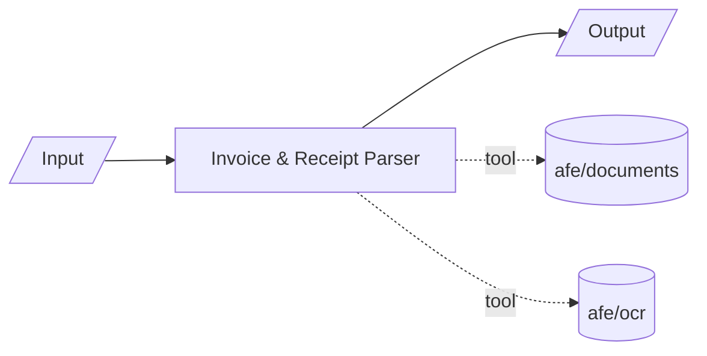

<!-- afe:begin-generated (scripts/build_readmes.py) — edit the manifest, not this block -->

[🏠 Agents for Everything](../../../../README.md) › [📖 Catalog](../../../../CATALOG.md) › [📄 Files and documents](../README.md) › **Invoice & Receipt Parser**

# 📄 Invoice & Receipt Parser

      

> Extracts vendor, date, line items, GST/VAT tax, and total from invoices and verifies the math.

Parses messy invoice/receipt text into validated financial records with arithmetic verification.

| | |
|---|---|
| **Use it when** | Automating accounts payable intake and expense claims. |
| **Don't use it when** | Executing bank transfers. |
| **Pattern** | `augmented-llm` |
| **Modality** | text |
| **Runtime** | interactive · memory: `none` |
| **Languages** | `en` |
| **Tags** | `documents` `invoice-receipt-parser` |

## 🚀 Quick start

```bash
afe add documents/invoice-receipt-parser          # copy this agent (and the agents it uses) into ./agents
afe info documents/invoice-receipt-parser         # manifest, tools, safety level
afe test documents/invoice-receipt-parser         # run its 50 eval cases
```

```python
from agents_for_everything import AgentRunner

payload = {"text": "Vendor: Acme Pvt Ltd\nInvoice #101\nSubtotal: INR 1000\nGST: INR 180\nTotal: INR 1180"}  # from evals/cases.jsonl
result = AgentRunner().run("documents/invoice-receipt-parser", payload)
print(result.output)
```

> No `afe` command yet? See [Install the CLI](../../../../README.md#-quick-start).

## 🧩 How it works



1. The input is validated against [`input.schema.json`](schemas/input.schema.json).
2. The runtime enforces safety level **S1** and allows only the tools declared in [`tools.yaml`](tools.yaml).
3. The agent follows its [system prompt](prompts/system.md) using the `augmented-llm` pattern.
4. The output is validated against [`output.schema.json`](schemas/output.schema.json) before it is returned.

## 📥 Input

| Field | Type | Required | Notes |
|---|---|:---:|---|
| `text` | `string` | ✅ |  |

## 📤 Output

| Field | Type | Required | Notes |
|---|---|:---:|---|
| `vendor` | `string` | ✅ |  |
| `invoice_number` | `string` |  |  |
| `subtotal` | `number` |  |  |
| `tax` | `number` |  |  |
| `total` | `number` | ✅ |  |
| `math_valid` | `boolean` | ✅ |  |

## 🔗 Composes with

- **Uses:** _none (atomic building block)_
- **Used by agents:** [`finance/accounts-payable`](../../../business/finance/accounts-payable/README.md), [`finance/accounts-receivable`](../../../business/finance/accounts-receivable/README.md), [`finance/audit-assistant`](../../../business/finance/audit-assistant/README.md), [`finance/earnings-call-analyzer`](../../../business/finance/earnings-call-analyzer/README.md), [`travel/trip-expense-reporter`](../../../life/travel/trip-expense-reporter/README.md)
- **In teams:** [`accounts-payable-team`](../../../../teams/accounts-payable-team/README.md)
- **In recipes:** [`invoice-automation`](../../../../recipes/invoice-automation/README.md)

## 🧰 Tools (MCP servers)

| Server | Required | What it provides |
|---|:---:|---|
| [`afe/documents`](../../../../mcp-servers/documents/README.md) | ✅ | Parse PDF, DOCX, PPTX, HTML, and spreadsheets into structured Markdown/tables. |
| [`afe/ocr`](../../../../mcp-servers/ocr/README.md) | ✅ | Printed and handwritten text extraction with layout bounding boxes. |

## 🛡️ Safety and limits

| | |
|---|---|
| **Safety level** | **S1** — Reads data: Read-only tool scopes; untrusted input screened for prompt injection |
| **Autonomy** | **L1** — human executes |
| **Side effects** | none |
| **Needs approval for** | nothing |
| **Handles personal data** | yes · retention: `none` |
| **Run limits** | 10 steps · 60 s · $0.03 max |

Full policy: [SECURITY.md](../../../../SECURITY.md).

## 📏 Evaluation

- **50 test cases** in [`evals/cases.jsonl`](evals/cases.jsonl), judged with [`evals/rubric.md`](evals/rubric.md).
- **Targets:** pass_rate ≥ 0.9 ([`eval.yaml`](evals/eval.yaml)).
- **Run:** `afe test documents/invoice-receipt-parser`

## 🧠 Model requirements

- **Needs:** `structured_output`
- **Context:** 8,000+ tokens
- **Tested with:** `frontier-large`, `frontier-small`, `open-weights-8b`
- **Exports:** `python`, `typescript`, `mcp-server`, `a2a-card`, `agent-skill`, `subagent`

## ⚠️ Limitations

Offline mock mode uses deterministic domain heuristics; connect a live model provider for open-ended reasoning.

## 📁 Files

| File | Purpose |
|---|---|
| [`agent.yaml`](agent.yaml) | Manifest: the single source of truth |
| [`prompts/system.md`](prompts/system.md) | Instructions the model follows |
| [`schemas/`](schemas/input.schema.json) | Input and output contracts |
| [`tools.yaml`](tools.yaml) | MCP servers and permissions |
| [`evals/`](evals/eval.yaml) | Test cases, rubric, targets |
| `impl/` | Python and TypeScript implementations |
| [`examples/basic.md`](examples/basic.md) | Worked example |
| [`CHANGELOG.md`](CHANGELOG.md) | Version history |

## 🤝 Help improve this agent

Add eval cases (especially non-English and edge cases), a live-model implementation, or a framework adapter. Start with the [contributing guide](../../../../CONTRIBUTING.md), or [open an issue](https://github.com/rupeshbharambe24/agents-for-everything/issues/new?title=%5Bdocuments/invoice-receipt-parser%5D%20) about this agent.

<!-- afe:end-generated -->
