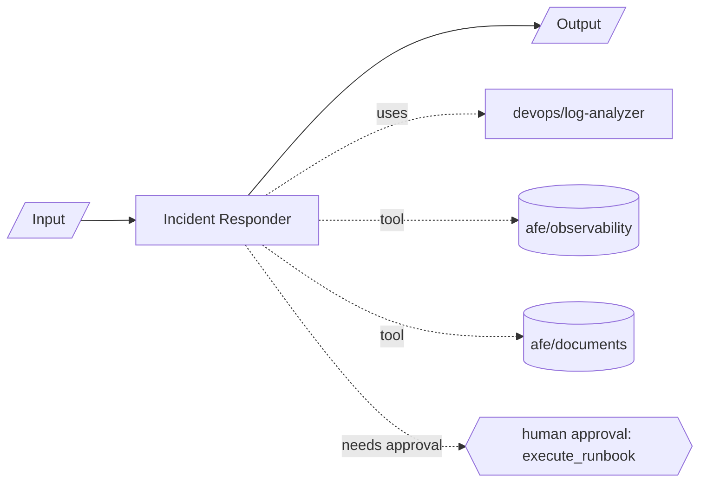

<!-- afe:begin-generated (scripts/build_readmes.py) — edit the manifest, not this block -->

[🏠 Agents for Everything](../../../../README.md) › [📖 Catalog](../../../../CATALOG.md) › [⚙️ DevOps, cloud and SRE](../README.md) › **Incident Responder**

# ⚙️ Incident Responder

      

> Correlates alerts, metrics, and recent deploys; suggests mitigations and runs approved runbooks.

Correlates alerts, metrics, and recent deploys; suggests mitigations and runs approved runbooks.

| | |
|---|---|
| **Use it when** | Performing incident responder tasks cleanly within typed I/O contracts. |
| **Don't use it when** | Tasks requiring capabilities outside declared tools or unapproved autonomous high-stakes actions. |
| **Pattern** | `augmented-llm` |
| **Modality** | text |
| **Runtime** | interactive · memory: `none` |
| **Languages** | `en` |
| **Tags** | `devops` `incident-responder` |

## 🚀 Quick start

```bash
afe add devops/incident-responder          # copy this agent (and the agents it uses) into ./agents
afe info devops/incident-responder         # manifest, tools, safety level
afe test devops/incident-responder         # run its 10 eval cases
```

```python
from agents_for_everything import AgentRunner

payload = {"input": "Sample incident-responder request #1"}  # from evals/cases.jsonl
result = AgentRunner().run("devops/incident-responder", payload)
print(result.output)
```

> No `afe` command yet? See [Install the CLI](../../../../README.md#-quick-start).

## 🧩 How it works



1. The input is validated against [`input.schema.json`](schemas/input.schema.json).
2. The runtime enforces safety level **S3** and allows only the tools declared in [`tools.yaml`](tools.yaml).
3. The agent follows its [system prompt](prompts/system.md) using the `augmented-llm` pattern, calling the agents it composes.
4. The output is validated against [`output.schema.json`](schemas/output.schema.json) before it is returned.

## 📥 Input

| Field | Type | Required | Notes |
|---|---|:---:|---|
| `input` | `string` | ✅ |  |
| `context` | `object` |  |  |

## 📤 Output

| Field | Type | Required | Notes |
|---|---|:---:|---|
| `result` | `string` | ✅ |  |
| `items` | array of `object` |  |  |
| `confidence` | `number` |  |  |
| `status` | `string` | ✅ |  |

## 🔗 Composes with

- **Uses:** [`devops/log-analyzer`](../log-analyzer/README.md)
- **Used by agents:** _none yet_
- **In teams:** [`incident-war-room`](../../../../teams/incident-war-room/README.md)

## 🧰 Tools (MCP servers)

| Server | Required | What it provides |
|---|:---:|---|
| [`afe/observability`](../../../../mcp-servers/observability/README.md) | ✅ | Query logs, metrics, traces, and active alerts across observability backends. |
| [`afe/documents`](../../../../mcp-servers/documents/README.md) | ✅ | Parse PDF, DOCX, PPTX, HTML, and spreadsheets into structured Markdown/tables. |

## 🛡️ Safety and limits

| | |
|---|---|
| **Safety level** | **S3** — External side effects: Human approval per action by default |
| **Autonomy** | **L2** — acts with per-action approval |
| **Side effects** | `devops-action` |
| **Needs approval for** | `execute_runbook` |
| **Handles personal data** | no · retention: `none` |
| **Run limits** | 10 steps · 60 s · $0.03 max |
| **Safety review** | [SAFETY_REVIEW.md](SAFETY_REVIEW.md) |

Full policy: [SECURITY.md](../../../../SECURITY.md).

## 📏 Evaluation

- **10 test cases** in [`evals/cases.jsonl`](evals/cases.jsonl), judged with [`evals/rubric.md`](evals/rubric.md).
- **Targets:** pass_rate ≥ 0.9 ([`eval.yaml`](evals/eval.yaml)).
- **Run:** `afe test devops/incident-responder`

## 🧠 Model requirements

- **Needs:** `structured_output`
- **Context:** 8,000+ tokens
- **Tested with:** `frontier-large`, `frontier-small`, `open-weights-8b`
- **Exports:** `python`, `typescript`, `mcp-server`, `a2a-card`, `agent-skill`, `subagent`

## ⚠️ Limitations

Offline mock mode uses deterministic domain heuristics; connect a live model provider for open-ended reasoning.

## 📁 Files

| File | Purpose |
|---|---|
| [`agent.yaml`](agent.yaml) | Manifest: the single source of truth |
| [`prompts/system.md`](prompts/system.md) | Instructions the model follows |
| [`schemas/`](schemas/input.schema.json) | Input and output contracts |
| [`tools.yaml`](tools.yaml) | MCP servers and permissions |
| [`evals/`](evals/eval.yaml) | Test cases, rubric, targets |
| `impl/` | Python and TypeScript implementations |
| [`examples/basic.md`](examples/basic.md) | Worked example |
| [`CHANGELOG.md`](CHANGELOG.md) | Version history |

## 🤝 Help improve this agent

Add eval cases (especially non-English and edge cases), a live-model implementation, or a framework adapter. Start with the [contributing guide](../../../../CONTRIBUTING.md), or [open an issue](https://github.com/rupeshbharambe24/agents-for-everything/issues/new?title=%5Bdevops/incident-responder%5D%20) about this agent.

<!-- afe:end-generated -->
