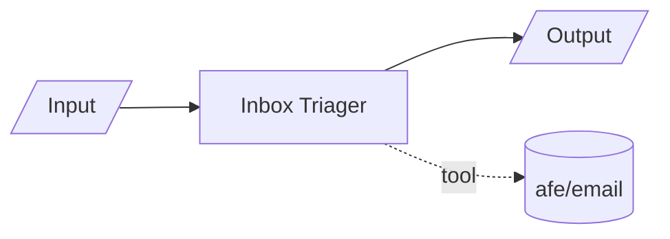

<!-- afe:begin-generated (scripts/build_readmes.py) — edit the manifest, not this block -->

[🏠 Agents for Everything](../../../../README.md) › [📖 Catalog](../../../../CATALOG.md) › [✉️ Email and messaging](../README.md) › **Inbox Triager**

# ✉️ Inbox Triager

      

> Sorts, prioritizes, and labels emails; surfaces urgent threads and reply-needed items.

Triage incoming email batches by urgency and actionability without sending replies.

| | |
|---|---|
| **Use it when** | Morning inbox triage and priority ranking. |
| **Don't use it when** | Deleting or sending emails autonomously. |
| **Pattern** | `augmented-llm` |
| **Modality** | text |
| **Runtime** | interactive · memory: `none` |
| **Languages** | `en` |
| **Tags** | `communication` `inbox-triager` |

## 🚀 Quick start

```bash
afe add communication/inbox-triager          # copy this agent (and the agents it uses) into ./agents
afe info communication/inbox-triager         # manifest, tools, safety level
afe test communication/inbox-triager         # run its 50 eval cases
```

```python
from agents_for_everything import AgentRunner

payload = {"emails": [{"id": "1", "subject": "URGENT invoice #1", "body": "Please respond ASAP"}, {"id": "2", "subject": "Weekly digest", "body": "FYI news"}]}  # from evals/cases.jsonl
result = AgentRunner().run("communication/inbox-triager", payload)
print(result.output)
```

> No `afe` command yet? See [Install the CLI](../../../../README.md#-quick-start).

## 🧩 How it works



1. The input is validated against [`input.schema.json`](schemas/input.schema.json).
2. The runtime enforces safety level **S1** and allows only the tools declared in [`tools.yaml`](tools.yaml).
3. The agent follows its [system prompt](prompts/system.md) using the `augmented-llm` pattern.
4. The output is validated against [`output.schema.json`](schemas/output.schema.json) before it is returned.

## 📥 Input

| Field | Type | Required | Notes |
|---|---|:---:|---|
| `emails` | array of `object` | ✅ |  |

## 📤 Output

| Field | Type | Required | Notes |
|---|---|:---:|---|
| `triaged` | array of `object` | ✅ |  |
| `urgent_count` | `integer` | ✅ |  |

## 🔗 Composes with

- **Uses:** _none (atomic building block)_
- **Used by agents:** [`productivity/daily-briefer`](../../../life/productivity/daily-briefer/README.md)
- **In teams:** [`chief-of-staff`](../../../../teams/chief-of-staff/README.md), [`inbox-zero`](../../../../teams/inbox-zero/README.md)
- **In recipes:** [`invoice-automation`](../../../../recipes/invoice-automation/README.md), [`personal-chief-of-staff`](../../../../recipes/personal-chief-of-staff/README.md)

## 🧰 Tools (MCP servers)

| Server | Required | What it provides |
|---|:---:|---|
| [`afe/email`](../../../../mcp-servers/email/README.md) | ✅ | Read inbox threads, apply labels, and create drafts without sending autonomously. |

## 🛡️ Safety and limits

| | |
|---|---|
| **Safety level** | **S1** — Reads data: Read-only tool scopes; untrusted input screened for prompt injection |
| **Autonomy** | **L1** — human executes |
| **Side effects** | none |
| **Needs approval for** | nothing |
| **Handles personal data** | yes · retention: `none` |
| **Run limits** | 10 steps · 60 s · $0.03 max |

Full policy: [SECURITY.md](../../../../SECURITY.md).

## 📏 Evaluation

- **50 test cases** in [`evals/cases.jsonl`](evals/cases.jsonl), judged with [`evals/rubric.md`](evals/rubric.md).
- **Targets:** pass_rate ≥ 0.9 ([`eval.yaml`](evals/eval.yaml)).
- **Run:** `afe test communication/inbox-triager`

## 🧠 Model requirements

- **Needs:** `structured_output`
- **Context:** 8,000+ tokens
- **Tested with:** `frontier-large`, `frontier-small`, `open-weights-8b`
- **Exports:** `python`, `typescript`, `mcp-server`, `a2a-card`, `agent-skill`, `subagent`

## ⚠️ Limitations

Offline mock mode uses deterministic domain heuristics; connect a live model provider for open-ended reasoning.

## 📁 Files

| File | Purpose |
|---|---|
| [`agent.yaml`](agent.yaml) | Manifest: the single source of truth |
| [`prompts/system.md`](prompts/system.md) | Instructions the model follows |
| [`schemas/`](schemas/input.schema.json) | Input and output contracts |
| [`tools.yaml`](tools.yaml) | MCP servers and permissions |
| [`evals/`](evals/eval.yaml) | Test cases, rubric, targets |
| `impl/` | Python and TypeScript implementations |
| [`examples/basic.md`](examples/basic.md) | Worked example |
| [`CHANGELOG.md`](CHANGELOG.md) | Version history |

## 🤝 Help improve this agent

Add eval cases (especially non-English and edge cases), a live-model implementation, or a framework adapter. Start with the [contributing guide](../../../../CONTRIBUTING.md), or [open an issue](https://github.com/rupeshbharambe24/agents-for-everything/issues/new?title=%5Bcommunication/inbox-triager%5D%20) about this agent.

<!-- afe:end-generated -->
