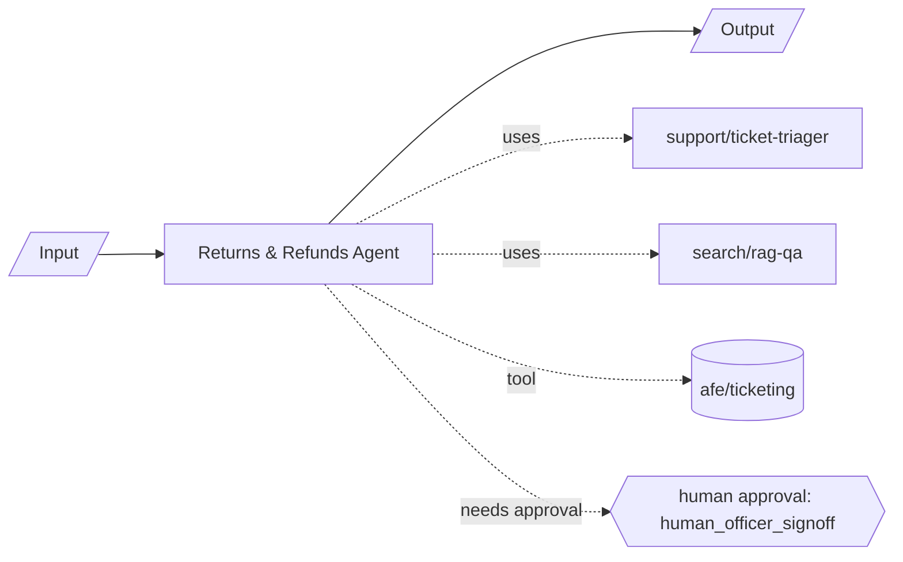

<!-- afe:begin-generated (scripts/build_readmes.py) — edit the manifest, not this block -->

[🏠 Agents for Everything](../../../../README.md) › [📖 Catalog](../../../../CATALOG.md) › [💬 Customer support and success](../README.md) › **Returns & Refunds Agent**

# 💬 Returns & Refunds Agent

      

> Checks return eligibility and prepares refunds; refunds need human approval.

Checks return eligibility and prepares refunds; refunds need human approval.

| | |
|---|---|
| **Use it when** | You need single-purpose returns & refunds agent (request → decision + prepared refund). |
| **Don't use it when** | Actions exceed declared MCP tools or bypass required human sign-off. |
| **Pattern** | `orchestrator-workers` |
| **Modality** | text |
| **Runtime** | interactive · memory: `session` |
| **Languages** | `en` |
| **Tags** | `business` `returns` `support` |

## 🚀 Quick start

```bash
afe add support/returns-refunds-agent          # copy this agent (and the agents it uses) into ./agents
afe info support/returns-refunds-agent         # manifest, tools, safety level
afe test support/returns-refunds-agent         # run its 10 eval cases
```

```python
from agents_for_everything import AgentRunner

payload = {"input": ""}  # from evals/cases.jsonl
result = AgentRunner().run("support/returns-refunds-agent", payload)
print(result.output)
```

> No `afe` command yet? See [Install the CLI](../../../../README.md#-quick-start).

## 🧩 How it works



1. The input is validated against [`input.schema.json`](schemas/input.schema.json).
2. The runtime enforces safety level **S4** and allows only the tools declared in [`tools.yaml`](tools.yaml).
3. The agent follows its [system prompt](prompts/system.md) using the `orchestrator-workers` pattern, calling the agents it composes.
4. The output is validated against [`output.schema.json`](schemas/output.schema.json) before it is returned.

## 📥 Input

| Field | Type | Required | Notes |
|---|---|:---:|---|
| `input` | `string` | ✅ | Primary task payload (request → decision + prepared refund) |
| `locale` | `string` |  | default `"en"` |
| `context` | `object` |  |  |
| `execute` | `boolean` |  | default `false` |

## 📤 Output

| Field | Type | Required | Notes |
|---|---|:---:|---|
| `result` | `string` | ✅ |  |
| `items` | array of `object` |  |  |
| `confidence` | `number` |  |  |
| `status` | `string` | ✅ |  |
| `locale` | `string` |  |  |

## 🔗 Composes with

- **Uses:** [`support/ticket-triager`](../ticket-triager/README.md), [`search/rag-qa`](../../../information/search/rag-qa/README.md)
- **Used by agents:** _none yet_

## 🧰 Tools (MCP servers)

| Server | Required | What it provides |
|---|:---:|---|
| [`afe/ticketing`](../../../../mcp-servers/ticketing/README.md) | ✅ | Read, classify, and prepare ticket updates across Zendesk, Jira Service Management, or Freshdesk. |

## 🛡️ Safety and limits

| | |
|---|---|
| **Safety level** | **S4** — High stakes: Mandatory human sign-off, immutable audit log, no autonomous mode |
| **Autonomy** | **L2** — acts with per-action approval |
| **Side effects** | `high-stakes-action-requires-human-signoff` |
| **Needs approval for** | `human_officer_signoff` |
| **Handles personal data** | yes · retention: `none` |
| **Run limits** | 10 steps · 60 s · $0.03 max |
| **Safety review** | [SAFETY_REVIEW.md](SAFETY_REVIEW.md) |

Full policy: [SECURITY.md](../../../../SECURITY.md).

## 📏 Evaluation

- **10 test cases** in [`evals/cases.jsonl`](evals/cases.jsonl), judged with [`evals/rubric.md`](evals/rubric.md).
- **Targets:** pass_rate ≥ 0.9 ([`eval.yaml`](evals/eval.yaml)).
- **Run:** `afe test support/returns-refunds-agent`

## 🧠 Model requirements

- **Needs:** `structured_output`, `tool_use`
- **Context:** 8,000+ tokens
- **Tested with:** `frontier-large`, `frontier-small`, `open-weights-8b`
- **Exports:** `python`, `typescript`, `mcp-server`, `a2a-card`, `agent-skill`, `subagent`

## ⚠️ Limitations

Offline mock mode uses deterministic structured heuristics; connect Ollama or a frontier model provider for open-ended reasoning.

## 📁 Files

| File | Purpose |
|---|---|
| [`agent.yaml`](agent.yaml) | Manifest: the single source of truth |
| [`prompts/system.md`](prompts/system.md) | Instructions the model follows |
| [`schemas/`](schemas/input.schema.json) | Input and output contracts |
| [`tools.yaml`](tools.yaml) | MCP servers and permissions |
| [`evals/`](evals/eval.yaml) | Test cases, rubric, targets |
| `impl/` | Python and TypeScript implementations |
| [`examples/basic.md`](examples/basic.md) | Worked example |
| [`CHANGELOG.md`](CHANGELOG.md) | Version history |

## 🤝 Help improve this agent

Add eval cases (especially non-English and edge cases), a live-model implementation, or a framework adapter. Start with the [contributing guide](../../../../CONTRIBUTING.md), or [open an issue](https://github.com/rupeshbharambe24/agents-for-everything/issues/new?title=%5Bsupport/returns-refunds-agent%5D%20) about this agent.

<!-- afe:end-generated -->
