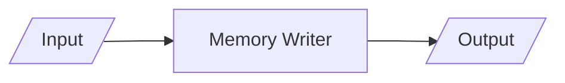

<!-- afe:begin-generated (scripts/build_readmes.py) — edit the manifest, not this block -->

[🏠 Agents for Everything](../../../../README.md) › [📖 Catalog](../../../../CATALOG.md) › [🧠 Memory and knowledge](../README.md) › **Memory Writer**

# 🧠 Memory Writer

      

> Extracts durable user preferences, facts, and decisions without creating duplicates.

Filters ephemeral noise and writes clean deduplicated memory records with consent.

| | |
|---|---|
| **Use it when** | Persisting preferences or project decisions across sessions. |
| **Don't use it when** | Zero-retention confidential runs. |
| **Pattern** | `augmented-llm` |
| **Modality** | text |
| **Runtime** | interactive · memory: `long-term` |
| **Languages** | `en` |
| **Tags** | `memory` `memory-writer` |

## 🚀 Quick start

```bash
afe add memory/memory-writer          # copy this agent (and the agents it uses) into ./agents
afe info memory/memory-writer         # manifest, tools, safety level
afe test memory/memory-writer         # run its 50 eval cases
```

```python
from agents_for_everything import AgentRunner

payload = {"interaction": "ok"}  # from evals/cases.jsonl
result = AgentRunner().run("memory/memory-writer", payload)
print(result.output)
```

> No `afe` command yet? See [Install the CLI](../../../../README.md#-quick-start).

## 🧩 How it works



1. The input is validated against [`input.schema.json`](schemas/input.schema.json).
2. The runtime enforces safety level **S2** and allows only the tools declared in [`tools.yaml`](tools.yaml).
3. The agent follows its [system prompt](prompts/system.md) using the `augmented-llm` pattern.
4. The output is validated against [`output.schema.json`](schemas/output.schema.json) before it is returned.

## 📥 Input

| Field | Type | Required | Notes |
|---|---|:---:|---|
| `interaction` | `string` | ✅ |  |
| `existing` | array of `string` |  |  |

## 📤 Output

| Field | Type | Required | Notes |
|---|---|:---:|---|
| `records` | array of `object` | ✅ |  |
| `skipped_duplicates` | `integer` | ✅ | min 0 |

## 🔗 Composes with

- **Uses:** _none (atomic building block)_
- **Used by agents:** [`gaming/game-master`](../../../industries/gaming/game-master/README.md), [`gaming/npc-agent`](../../../industries/gaming/npc-agent/README.md)

## 🧰 Tools (MCP servers)

_No tools: this agent works only on its input._

## 🛡️ Safety and limits

| | |
|---|---|
| **Safety level** | **S2** — Reversible writes: Drafts and local changes with preview, undo and logging |
| **Autonomy** | **L2** — acts with per-action approval |
| **Side effects** | `writes-memory-store` |
| **Needs approval for** | nothing |
| **Handles personal data** | yes · retention: `none` |
| **Run limits** | 10 steps · 60 s · $0.02 max |

Full policy: [SECURITY.md](../../../../SECURITY.md).

## 📏 Evaluation

- **50 test cases** in [`evals/cases.jsonl`](evals/cases.jsonl), judged with [`evals/rubric.md`](evals/rubric.md).
- **Targets:** pass_rate ≥ 0.9 ([`eval.yaml`](evals/eval.yaml)).
- **Run:** `afe test memory/memory-writer`

## 🧠 Model requirements

- **Needs:** `structured_output`
- **Context:** 8,000+ tokens
- **Tested with:** `frontier-large`, `frontier-small`, `open-weights-8b`
- **Exports:** `python`, `typescript`, `mcp-server`, `a2a-card`, `agent-skill`, `subagent`

## ⚠️ Limitations

Deterministic offline fallback operates heuristically; connect a live model provider for complex semantic cases.

## 📁 Files

| File | Purpose |
|---|---|
| [`agent.yaml`](agent.yaml) | Manifest: the single source of truth |
| [`prompts/system.md`](prompts/system.md) | Instructions the model follows |
| [`schemas/`](schemas/input.schema.json) | Input and output contracts |
| [`tools.yaml`](tools.yaml) | MCP servers and permissions |
| [`evals/`](evals/eval.yaml) | Test cases, rubric, targets |
| `impl/` | Python and TypeScript implementations |
| [`examples/basic.md`](examples/basic.md) | Worked example |
| [`CHANGELOG.md`](CHANGELOG.md) | Version history |

## 🤝 Help improve this agent

Add eval cases (especially non-English and edge cases), a live-model implementation, or a framework adapter. Start with the [contributing guide](../../../../CONTRIBUTING.md), or [open an issue](https://github.com/rupeshbharambe24/agents-for-everything/issues/new?title=%5Bmemory/memory-writer%5D%20) about this agent.

<!-- afe:end-generated -->
