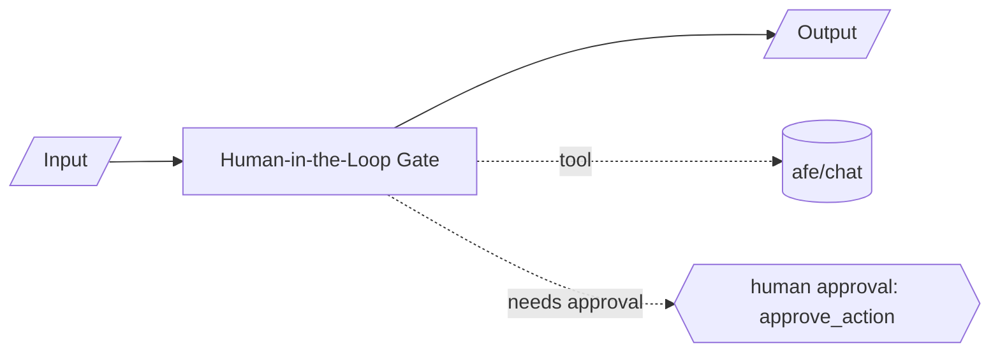

<!-- afe:begin-generated (scripts/build_readmes.py) — edit the manifest, not this block -->

[🏠 Agents for Everything](../../../../README.md) › [📖 Catalog](../../../../CATALOG.md) › [🧭 Orchestration and meta-agents](../README.md) › **Human-in-the-Loop Gate**

# 🧭 Human-in-the-Loop Gate

      

> Pauses a workflow before risky steps, displays a clear summary/diff, and records approve/reject decisions.

Enforces explicit human confirmation and emits an audit log entry prior to external or high-stakes actions.

| | |
|---|---|
| **Use it when** | Before submitting forms, sending emails, running destructive shell commands, or moving money. |
| **Don't use it when** | Pure read-only S0 calculations. |
| **Pattern** | `human-in-the-loop` |
| **Modality** | text |
| **Runtime** | interactive · memory: `none` |
| **Languages** | `en` |
| **Tags** | `orchestration` `human-approval-gate` |

## 🚀 Quick start

```bash
afe add orchestration/human-approval-gate          # copy this agent (and the agents it uses) into ./agents
afe info orchestration/human-approval-gate         # manifest, tools, safety level
afe test orchestration/human-approval-gate         # run its 50 eval cases
```

```python
from agents_for_everything import AgentRunner

payload = {"action": "send_email", "summary": "Send reply"}  # from evals/cases.jsonl
result = AgentRunner().run("orchestration/human-approval-gate", payload)
print(result.output)
```

> No `afe` command yet? See [Install the CLI](../../../../README.md#-quick-start).

## 🧩 How it works



1. The input is validated against [`input.schema.json`](schemas/input.schema.json).
2. The runtime enforces safety level **S1** and allows only the tools declared in [`tools.yaml`](tools.yaml).
3. The agent follows its [system prompt](prompts/system.md) using the `human-in-the-loop` pattern.
4. The output is validated against [`output.schema.json`](schemas/output.schema.json) before it is returned.

## 📥 Input

| Field | Type | Required | Notes |
|---|---|:---:|---|
| `action` | `string` | ✅ |  |
| `summary` | `string` | ✅ |  |
| `safety_level` | enum |  | one of `S0`, `S1`, `S2`, `S3`, `S4`; default `"S2"` |
| `user_response` | enum |  | one of `yes`, `approve`, `no`, `reject`, `edit` |

## 📤 Output

| Field | Type | Required | Notes |
|---|---|:---:|---|
| `decision` | enum | ✅ | one of `approved`, `rejected`, `needs_edit` |
| `audit_entry` | [`AuditEvent`](../../../../spec/types/AuditEvent.schema.json) | ✅ |  |
| `notes` | `string` | ✅ |  |

## 🔗 Composes with

- **Uses:** _none (atomic building block)_
- **Used by agents:** [`physical/drone-mission-planner`](../../../action/physical/drone-mission-planner/README.md), [`physical/robot-task-planner`](../../../action/physical/robot-task-planner/README.md), [`voice/voice-form-filler`](../../../perception/voice/voice-form-filler/README.md)
- **In teams:** [`accounts-payable-team`](../../../../teams/accounts-payable-team/README.md), [`contract-desk`](../../../../teams/contract-desk/README.md), [`document-intake`](../../../../teams/document-intake/README.md), [`hiring-pipeline`](../../../../teams/hiring-pipeline/README.md), [`inbox-zero`](../../../../teams/inbox-zero/README.md), [`incident-war-room`](../../../../teams/incident-war-room/README.md), [`kyc-pipeline`](../../../../teams/kyc-pipeline/README.md), [`support-desk`](../../../../teams/support-desk/README.md)
- **In recipes:** [`invoice-automation`](../../../../recipes/invoice-automation/README.md), [`voice-form-filling`](../../../../recipes/voice-form-filling/README.md)

## 🧰 Tools (MCP servers)

| Server | Required | What it provides |
|---|:---:|---|
| [`afe/chat`](../../../../mcp-servers/chat/README.md) | ✅ | Read channels/threads and draft replies across Slack, Teams, Discord, or WhatsApp. |

## 🛡️ Safety and limits

| | |
|---|---|
| **Safety level** | **S1** — Reads data: Read-only tool scopes; untrusted input screened for prompt injection |
| **Autonomy** | **L2** — acts with per-action approval |
| **Side effects** | none |
| **Needs approval for** | `approve_action` |
| **Handles personal data** | no · retention: `none` |
| **Run limits** | 10 steps · 60 s · $0.02 max |

Full policy: [SECURITY.md](../../../../SECURITY.md).

## 📏 Evaluation

- **50 test cases** in [`evals/cases.jsonl`](evals/cases.jsonl), judged with [`evals/rubric.md`](evals/rubric.md).
- **Targets:** pass_rate ≥ 0.9 ([`eval.yaml`](evals/eval.yaml)).
- **Run:** `afe test orchestration/human-approval-gate`

## 🧠 Model requirements

- **Needs:** `structured_output`
- **Context:** 8,000+ tokens
- **Tested with:** `frontier-large`, `frontier-small`, `open-weights-8b`
- **Exports:** `python`, `typescript`, `mcp-server`, `a2a-card`, `agent-skill`, `subagent`

## ⚠️ Limitations

Deterministic offline fallback operates heuristically; connect a live model provider for complex semantic cases.

## 📁 Files

| File | Purpose |
|---|---|
| [`agent.yaml`](agent.yaml) | Manifest: the single source of truth |
| [`prompts/system.md`](prompts/system.md) | Instructions the model follows |
| [`schemas/`](schemas/input.schema.json) | Input and output contracts |
| [`tools.yaml`](tools.yaml) | MCP servers and permissions |
| [`evals/`](evals/eval.yaml) | Test cases, rubric, targets |
| `impl/` | Python and TypeScript implementations |
| [`examples/basic.md`](examples/basic.md) | Worked example |
| [`CHANGELOG.md`](CHANGELOG.md) | Version history |

## 🤝 Help improve this agent

Add eval cases (especially non-English and edge cases), a live-model implementation, or a framework adapter. Start with the [contributing guide](../../../../CONTRIBUTING.md), or [open an issue](https://github.com/rupeshbharambe24/agents-for-everything/issues/new?title=%5Borchestration/human-approval-gate%5D%20) about this agent.

<!-- afe:end-generated -->
