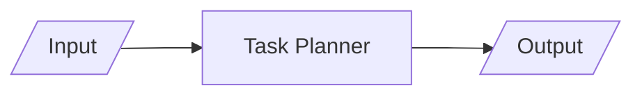

<!-- afe:begin-generated (scripts/build_readmes.py) — edit the manifest, not this block -->

[🏠 Agents for Everything](../../../../README.md) › [📖 Catalog](../../../../CATALOG.md) › [🧭 Orchestration and meta-agents](../README.md) › **Task Planner**

# 🧭 Task Planner

      

> Breaks a goal into ordered, dependency-aware steps with success criteria and estimated cost.

Decomposes complex multi-step goals into an acyclic execution plan (DAG) of atomic agent calls.

| | |
|---|---|
| **Use it when** | Planning multi-step workflows before calling execution agents. |
| **Don't use it when** | Single-step atomic transformations. |
| **Pattern** | `plan-and-execute` |
| **Modality** | text |
| **Runtime** | interactive · memory: `none` |
| **Languages** | `en` |
| **Tags** | `orchestration` `task-planner` |

## 🚀 Quick start

```bash
afe add orchestration/task-planner          # copy this agent (and the agents it uses) into ./agents
afe info orchestration/task-planner         # manifest, tools, safety level
afe test orchestration/task-planner         # run its 50 eval cases
```

```python
from agents_for_everything import AgentRunner

payload = {"goal": "Fill a loan form by voice"}  # from evals/cases.jsonl
result = AgentRunner().run("orchestration/task-planner", payload)
print(result.output)
```

> No `afe` command yet? See [Install the CLI](../../../../README.md#-quick-start).

## 🧩 How it works



1. The input is validated against [`input.schema.json`](schemas/input.schema.json).
2. The runtime enforces safety level **S0** and allows only the tools declared in [`tools.yaml`](tools.yaml).
3. The agent follows its [system prompt](prompts/system.md) using the `plan-and-execute` pattern.
4. The output is validated against [`output.schema.json`](schemas/output.schema.json) before it is returned.

## 📥 Input

| Field | Type | Required | Notes |
|---|---|:---:|---|
| `goal` | `string` | ✅ | min length 1 |
| `context` | `object` |  |  |
| `available_agents` | array of `string` |  |  |

## 📤 Output

| Field | Type | Required | Notes |
|---|---|:---:|---|
| `steps` | array of `object` | ✅ |  |
| `estimated_cost_usd` | `number` | ✅ | min 0 |

## 🔗 Composes with

- **Uses:** _none (atomic building block)_
- **Used by agents:** [`integration/workflow-builder`](../../../action/integration/workflow-builder/README.md), [`operations/process-miner`](../../../business/operations/process-miner/README.md), [`operations/product-feedback-prioritizer`](../../../business/operations/product-feedback-prioritizer/README.md), [`operations/project-manager`](../../../business/operations/project-manager/README.md), [`operations/vendor-manager`](../../../business/operations/vendor-manager/README.md), [`orchestration/agent-builder`](../agent-builder/README.md), [`orchestration/debate-moderator`](../debate-moderator/README.md), [`orchestration/prompt-optimizer`](../prompt-optimizer/README.md), [`orchestration/supervisor`](../supervisor/README.md)
- **In teams:** [`research-team`](../../../../teams/research-team/README.md)
- **In recipes:** [`deep-research-app`](../../../../recipes/deep-research-app/README.md)

## 🧰 Tools (MCP servers)

_No tools: this agent works only on its input._

## 🛡️ Safety and limits

| | |
|---|---|
| **Safety level** | **S0** — Pure computation: No external access; schema validation only |
| **Autonomy** | **L1** — human executes |
| **Side effects** | none |
| **Needs approval for** | nothing |
| **Handles personal data** | no · retention: `none` |
| **Run limits** | 10 steps · 60 s · $0.02 max |

Full policy: [SECURITY.md](../../../../SECURITY.md).

## 📏 Evaluation

- **50 test cases** in [`evals/cases.jsonl`](evals/cases.jsonl), judged with [`evals/rubric.md`](evals/rubric.md).
- **Targets:** pass_rate ≥ 0.9 ([`eval.yaml`](evals/eval.yaml)).
- **Run:** `afe test orchestration/task-planner`

## 🧠 Model requirements

- **Needs:** `structured_output`
- **Context:** 8,000+ tokens
- **Tested with:** `frontier-large`, `frontier-small`, `open-weights-8b`
- **Exports:** `python`, `typescript`, `mcp-server`, `a2a-card`, `agent-skill`, `subagent`

## ⚠️ Limitations

Deterministic offline fallback operates heuristically; connect a live model provider for complex semantic cases.

## 📁 Files

| File | Purpose |
|---|---|
| [`agent.yaml`](agent.yaml) | Manifest: the single source of truth |
| [`prompts/system.md`](prompts/system.md) | Instructions the model follows |
| [`schemas/`](schemas/input.schema.json) | Input and output contracts |
| [`tools.yaml`](tools.yaml) | MCP servers and permissions |
| [`evals/`](evals/eval.yaml) | Test cases, rubric, targets |
| `impl/` | Python and TypeScript implementations |
| [`examples/basic.md`](examples/basic.md) | Worked example |
| [`CHANGELOG.md`](CHANGELOG.md) | Version history |

## 🤝 Help improve this agent

Add eval cases (especially non-English and edge cases), a live-model implementation, or a framework adapter. Start with the [contributing guide](../../../../CONTRIBUTING.md), or [open an issue](https://github.com/rupeshbharambe24/agents-for-everything/issues/new?title=%5Borchestration/task-planner%5D%20) about this agent.

<!-- afe:end-generated -->
