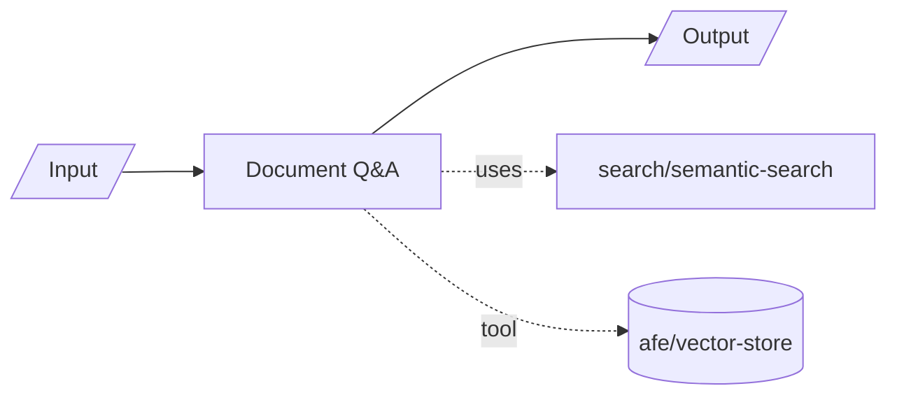

<!-- afe:begin-generated (scripts/build_readmes.py) — edit the manifest, not this block -->

[🏠 Agents for Everything](../../../../README.md) › [📖 Catalog](../../../../CATALOG.md) › [🔎 Search and retrieval](../README.md) › **Document Q&A**

# 🔎 Document Q&A

      

> Answers questions over private documents with citations and refuses when unsupported.

Composes semantic search to synthesize grounded answers with explicit citations.

| | |
|---|---|
| **Use it when** | Question answering over internal docs or manuals. |
| **Don't use it when** | Open web exploration. |
| **Pattern** | `augmented-llm` |
| **Modality** | text |
| **Runtime** | interactive · memory: `none` |
| **Languages** | `en` |
| **Tags** | `search` `rag-qa` |

## 🚀 Quick start

```bash
afe add search/rag-qa          # copy this agent (and the agents it uses) into ./agents
afe info search/rag-qa         # manifest, tools, safety level
afe test search/rag-qa         # run its 50 eval cases
```

```python
from agents_for_everything import AgentRunner

payload = {"question": "What is Mars gravity?", "documents": [{"title": "FAQ", "content": "Our refund window is 30 days from purchase."}]}  # from evals/cases.jsonl
result = AgentRunner().run("search/rag-qa", payload)
print(result.output)
```

> No `afe` command yet? See [Install the CLI](../../../../README.md#-quick-start).

## 🧩 How it works



1. The input is validated against [`input.schema.json`](schemas/input.schema.json).
2. The runtime enforces safety level **S1** and allows only the tools declared in [`tools.yaml`](tools.yaml).
3. The agent follows its [system prompt](prompts/system.md) using the `augmented-llm` pattern, calling the agents it composes.
4. The output is validated against [`output.schema.json`](schemas/output.schema.json) before it is returned.

## 📥 Input

| Field | Type | Required | Notes |
|---|---|:---:|---|
| `question` | `string` | ✅ |  |
| `documents` | array of `object` | ✅ |  |

## 📤 Output

| Field | Type | Required | Notes |
|---|---|:---:|---|
| `answer` | `string` | ✅ |  |
| `citations` | array of [`Citation`](../../../../spec/types/Citation.schema.json) | ✅ |  |
| `supported` | `boolean` | ✅ |  |

## 🔗 Composes with

- **Uses:** [`search/semantic-search`](../semantic-search/README.md)
- **Used by agents:** [`ai-engineering/automl-trainer`](../../../builders/ai-engineering/automl-trainer/README.md), [`ai-engineering/paper-to-code`](../../../builders/ai-engineering/paper-to-code/README.md), [`banking/financial-literacy-guide`](../../../industries/banking/financial-literacy-guide/README.md), [`community/community-qa-bot`](../../../life/community/community-qa-bot/README.md), [`documents/long-doc-navigator`](../../../action/documents/long-doc-navigator/README.md), [`government/citizen-services-assistant`](../../../industries/government/citizen-services-assistant/README.md), [`government/gov-form-assistant`](../../../industries/government/gov-form-assistant/README.md), [`government/public-consultation-analyzer`](../../../industries/government/public-consultation-analyzer/README.md), [`government/tender-analyzer`](../../../industries/government/tender-analyzer/README.md), [`hospitality/hotel-concierge`](../../../industries/hospitality/hotel-concierge/README.md), [`hospitality/reservation-agent`](../../../industries/hospitality/reservation-agent/README.md), [`hr/hr-policy-qa`](../../../business/hr/hr-policy-qa/README.md), [`hr/onboarding-buddy`](../../../business/hr/onboarding-buddy/README.md), [`it-support/helpdesk-agent`](../../../builders/it-support/helpdesk-agent/README.md), [`manufacturing/maintenance-copilot`](../../../industries/manufacturing/maintenance-copilot/README.md), [`manufacturing/predictive-maintenance`](../../../industries/manufacturing/predictive-maintenance/README.md), [`manufacturing/quality-inspector`](../../../industries/manufacturing/quality-inspector/README.md), [`meetings/live-meeting-copilot`](../../../business/meetings/live-meeting-copilot/README.md), [`productivity/personal-knowledge-qa`](../../../life/productivity/personal-knowledge-qa/README.md), [`sales/rfp-responder`](../../../business/sales/rfp-responder/README.md), [`search/multimodal-search`](../multimodal-search/README.md), [`support/customer-onboarding-guide`](../../../business/support/customer-onboarding-guide/README.md), [`support/reply-drafter`](../../../business/support/reply-drafter/README.md), [`support/returns-refunds-agent`](../../../business/support/returns-refunds-agent/README.md), [`support/support-chatbot`](../../../business/support/support-chatbot/README.md)
- **In recipes:** [`ai-receptionist`](../../../../recipes/ai-receptionist/README.md), [`chat-with-your-docs`](../../../../recipes/chat-with-your-docs/README.md)

## 🧰 Tools (MCP servers)

| Server | Required | What it provides |
|---|:---:|---|
| [`afe/vector-store`](../../../../mcp-servers/vector-store/README.md) | ✅ | Hybrid keyword + semantic indexing and retrieval with metadata ACL filters. |

## 🛡️ Safety and limits

| | |
|---|---|
| **Safety level** | **S1** — Reads data: Read-only tool scopes; untrusted input screened for prompt injection |
| **Autonomy** | **L1** — human executes |
| **Side effects** | none |
| **Needs approval for** | nothing |
| **Handles personal data** | no · retention: `none` |
| **Run limits** | 10 steps · 60 s · $0.03 max |

Full policy: [SECURITY.md](../../../../SECURITY.md).

## 📏 Evaluation

- **50 test cases** in [`evals/cases.jsonl`](evals/cases.jsonl), judged with [`evals/rubric.md`](evals/rubric.md).
- **Targets:** pass_rate ≥ 0.9 ([`eval.yaml`](evals/eval.yaml)).
- **Run:** `afe test search/rag-qa`

## 🧠 Model requirements

- **Needs:** `structured_output`
- **Context:** 8,000+ tokens
- **Tested with:** `frontier-large`, `frontier-small`, `open-weights-8b`
- **Exports:** `python`, `typescript`, `mcp-server`, `a2a-card`, `agent-skill`, `subagent`

## ⚠️ Limitations

Offline mock mode uses deterministic domain heuristics; connect a live model provider for open-ended reasoning.

## 📁 Files

| File | Purpose |
|---|---|
| [`agent.yaml`](agent.yaml) | Manifest: the single source of truth |
| [`prompts/system.md`](prompts/system.md) | Instructions the model follows |
| [`schemas/`](schemas/input.schema.json) | Input and output contracts |
| [`tools.yaml`](tools.yaml) | MCP servers and permissions |
| [`evals/`](evals/eval.yaml) | Test cases, rubric, targets |
| `impl/` | Python and TypeScript implementations |
| [`examples/basic.md`](examples/basic.md) | Worked example |
| [`CHANGELOG.md`](CHANGELOG.md) | Version history |

## 🤝 Help improve this agent

Add eval cases (especially non-English and edge cases), a live-model implementation, or a framework adapter. Start with the [contributing guide](../../../../CONTRIBUTING.md), or [open an issue](https://github.com/rupeshbharambe24/agents-for-everything/issues/new?title=%5Bsearch/rag-qa%5D%20) about this agent.

<!-- afe:end-generated -->
