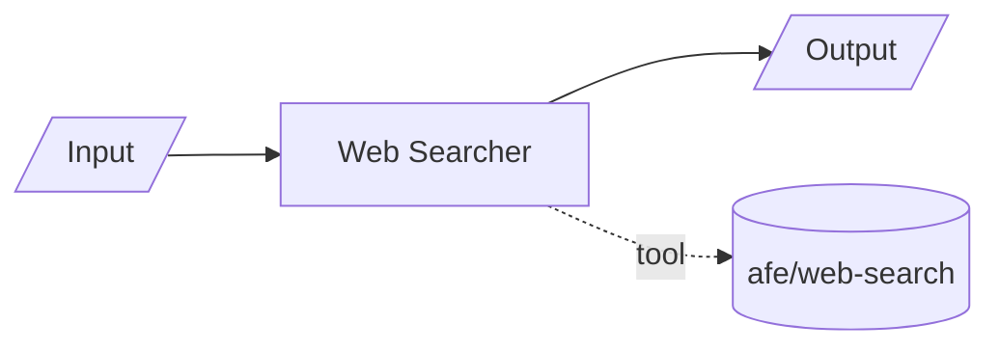

<!-- afe:begin-generated (scripts/build_readmes.py) — edit the manifest, not this block -->

[🏠 Agents for Everything](../../../../README.md) › [📖 Catalog](../../../../CATALOG.md) › [🔎 Search and retrieval](../README.md) › **Web Searcher**

# 🔎 Web Searcher

      

> Runs queries on search APIs, deduplicates URLs, and ranks results with snippets.

Provides clean deduplicated SearchResult items for answer engines and researchers.

| | |
|---|---|
| **Use it when** | Retrieving live external web references. |
| **Don't use it when** | Searching private local files or vector stores. |
| **Pattern** | `augmented-llm` |
| **Modality** | text |
| **Runtime** | interactive · memory: `none` |
| **Languages** | `en` |
| **Tags** | `search` `web-search` |

## 🚀 Quick start

```bash
afe add search/web-search          # copy this agent (and the agents it uses) into ./agents
afe info search/web-search         # manifest, tools, safety level
afe test search/web-search         # run its 50 eval cases
```

```python
from agents_for_everything import AgentRunner

payload = {"query": "MCP specification v1"}  # from evals/cases.jsonl
result = AgentRunner().run("search/web-search", payload)
print(result.output)
```

> No `afe` command yet? See [Install the CLI](../../../../README.md#-quick-start).

## 🧩 How it works



1. The input is validated against [`input.schema.json`](schemas/input.schema.json).
2. The runtime enforces safety level **S1** and allows only the tools declared in [`tools.yaml`](tools.yaml).
3. The agent follows its [system prompt](prompts/system.md) using the `augmented-llm` pattern.
4. The output is validated against [`output.schema.json`](schemas/output.schema.json) before it is returned.

## 📥 Input

| Field | Type | Required | Notes |
|---|---|:---:|---|
| `query` | `string` | ✅ |  |
| `fixtures` | array of `object` |  |  |

## 📤 Output

| Field | Type | Required | Notes |
|---|---|:---:|---|
| `query` | `string` | ✅ |  |
| `results` | array of [`SearchResult`](../../../../spec/types/SearchResult.schema.json) | ✅ |  |

## 🔗 Composes with

- **Uses:** _none (atomic building block)_
- **Used by agents:** [`content/blog-writer`](../../../business/content/blog-writer/README.md), [`hr/candidate-sourcer`](../../../business/hr/candidate-sourcer/README.md), [`personal/digital-declutterer`](../../../life/personal/digital-declutterer/README.md), [`personal/event-planner`](../../../life/personal/event-planner/README.md), [`personal/meal-planner`](../../../life/personal/meal-planner/README.md), [`personal/shopping-assistant`](../../../life/personal/shopping-assistant/README.md), [`research/competitive-analyst`](../../research/competitive-analyst/README.md), [`research/deep-researcher`](../../research/deep-researcher/README.md), [`research/due-diligence`](../../research/due-diligence/README.md), [`research/fact-checker`](../../research/fact-checker/README.md), [`research/market-researcher`](../../research/market-researcher/README.md), [`research/policy-analyst`](../../research/policy-analyst/README.md), [`research/trend-spotter`](../../research/trend-spotter/README.md), [`sales/account-researcher`](../../../business/sales/account-researcher/README.md), [`sales/lead-finder`](../../../business/sales/lead-finder/README.md), [`search/answer-engine`](../answer-engine/README.md), [`strategy/strategy-analyst`](../../../business/strategy/strategy-analyst/README.md), [`supply-chain/purchase-order-agent`](../../../business/supply-chain/purchase-order-agent/README.md), [`supply-chain/supplier-risk-monitor`](../../../business/supply-chain/supplier-risk-monitor/README.md), [`supply-chain/supplier-sourcer`](../../../business/supply-chain/supplier-sourcer/README.md), [`travel/trip-planner`](../../../life/travel/trip-planner/README.md), [`voice/voice-search`](../../../perception/voice/voice-search/README.md)
- **In teams:** [`ecosystem-radar`](../../../../teams/ecosystem-radar/README.md), [`research-team`](../../../../teams/research-team/README.md)
- **In recipes:** [`deep-research-app`](../../../../recipes/deep-research-app/README.md)

## 🧰 Tools (MCP servers)

| Server | Required | What it provides |
|---|:---:|---|
| [`afe/web-search`](../../../../mcp-servers/web-search/README.md) | ✅ | Search web indexes and return ranked snippets and URLs. |

## 🛡️ Safety and limits

| | |
|---|---|
| **Safety level** | **S1** — Reads data: Read-only tool scopes; untrusted input screened for prompt injection |
| **Autonomy** | **L1** — human executes |
| **Side effects** | none |
| **Needs approval for** | nothing |
| **Handles personal data** | no · retention: `none` |
| **Run limits** | 10 steps · 60 s · $0.03 max |

Full policy: [SECURITY.md](../../../../SECURITY.md).

## 📏 Evaluation

- **50 test cases** in [`evals/cases.jsonl`](evals/cases.jsonl), judged with [`evals/rubric.md`](evals/rubric.md).
- **Targets:** pass_rate ≥ 0.9 ([`eval.yaml`](evals/eval.yaml)).
- **Run:** `afe test search/web-search`

## 🧠 Model requirements

- **Needs:** `structured_output`
- **Context:** 8,000+ tokens
- **Tested with:** `frontier-large`, `frontier-small`, `open-weights-8b`
- **Exports:** `python`, `typescript`, `mcp-server`, `a2a-card`, `agent-skill`, `subagent`

## ⚠️ Limitations

Offline mock mode uses deterministic domain heuristics; connect a live model provider for open-ended reasoning.

## 📁 Files

| File | Purpose |
|---|---|
| [`agent.yaml`](agent.yaml) | Manifest: the single source of truth |
| [`prompts/system.md`](prompts/system.md) | Instructions the model follows |
| [`schemas/`](schemas/input.schema.json) | Input and output contracts |
| [`tools.yaml`](tools.yaml) | MCP servers and permissions |
| [`evals/`](evals/eval.yaml) | Test cases, rubric, targets |
| `impl/` | Python and TypeScript implementations |
| [`examples/basic.md`](examples/basic.md) | Worked example |
| [`CHANGELOG.md`](CHANGELOG.md) | Version history |

## 🤝 Help improve this agent

Add eval cases (especially non-English and edge cases), a live-model implementation, or a framework adapter. Start with the [contributing guide](../../../../CONTRIBUTING.md), or [open an issue](https://github.com/rupeshbharambe24/agents-for-everything/issues/new?title=%5Bsearch/web-search%5D%20) about this agent.

<!-- afe:end-generated -->
