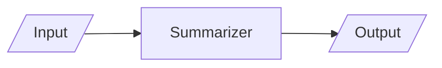

<!-- afe:begin-generated (scripts/build_readmes.py) — edit the manifest, not this block -->

[🏠 Agents for Everything](../../../../README.md) › [📖 Catalog](../../../../CATALOG.md) › [📝 Language and text](../README.md) › **Summarizer**

# 📝 Summarizer

      

> Summarizes any length of content in a chosen style (TL;DR, bullets, executive) with key points.

Condenses documents, emails, and articles faithfully without inventing facts.

| | |
|---|---|
| **Use it when** | Condensing long text into crisp summaries. |
| **Don't use it when** | Lossless structured field extraction. |
| **Pattern** | `augmented-llm` |
| **Modality** | text |
| **Runtime** | interactive · memory: `none` |
| **Languages** | `en`, `hi`, `es`, `fr` |
| **Tags** | `text` `summarizer` |

## 🚀 Quick start

```bash
afe add text/summarizer          # copy this agent (and the agents it uses) into ./agents
afe info text/summarizer         # manifest, tools, safety level
afe test text/summarizer         # run its 50 eval cases
```

```python
from agents_for_everything import AgentRunner

payload = {"text": "Sentence one about topic 1. Sentence two adds metrics. Sentence three concludes.", "style": "tldr"}  # from evals/cases.jsonl
result = AgentRunner().run("text/summarizer", payload)
print(result.output)
```

> No `afe` command yet? See [Install the CLI](../../../../README.md#-quick-start).

## 🧩 How it works



1. The input is validated against [`input.schema.json`](schemas/input.schema.json).
2. The runtime enforces safety level **S0** and allows only the tools declared in [`tools.yaml`](tools.yaml).
3. The agent follows its [system prompt](prompts/system.md) using the `augmented-llm` pattern.
4. The output is validated against [`output.schema.json`](schemas/output.schema.json) before it is returned.

## 📥 Input

| Field | Type | Required | Notes |
|---|---|:---:|---|
| `text` | `string` | ✅ |  |
| `style` | enum |  | one of `tldr`, `bullets`, `executive`; default `"bullets"` |
| `max_sentences` | `integer` |  | default `3` |

## 📤 Output

| Field | Type | Required | Notes |
|---|---|:---:|---|
| `summary` | `string` | ✅ |  |
| `key_points` | array of `string` | ✅ |  |

## 🔗 Composes with

- **Uses:** _none (atomic building block)_
- **Used by agents:** [`audio/audio-search`](../../../perception/audio/audio-search/README.md), [`audio/podcast-producer`](../../../perception/audio/podcast-producer/README.md), [`communication/newsletter-digest`](../../../business/communication/newsletter-digest/README.md), [`content/content-repurposer`](../../../business/content/content-repurposer/README.md), [`content/grant-writer`](../../../business/content/grant-writer/README.md), [`documents/slide-deck-builder`](../../../action/documents/slide-deck-builder/README.md), [`legal/ediscovery-reviewer`](../../../business/legal/ediscovery-reviewer/README.md), [`legal/legal-researcher`](../../../business/legal/legal-researcher/README.md), [`legal/redline-negotiator`](../../../business/legal/redline-negotiator/README.md), [`meetings/meeting-notetaker`](../../../business/meetings/meeting-notetaker/README.md), [`meetings/meeting-prep`](../../../business/meetings/meeting-prep/README.md), [`memory/wiki-maintainer`](../../../core/memory/wiki-maintainer/README.md), [`operations/process-miner`](../../../business/operations/process-miner/README.md), [`operations/product-feedback-prioritizer`](../../../business/operations/product-feedback-prioritizer/README.md), [`operations/status-reporter`](../../../business/operations/status-reporter/README.md), [`operations/vendor-manager`](../../../business/operations/vendor-manager/README.md), [`sales/inbound-qualifier`](../../../business/sales/inbound-qualifier/README.md), [`strategy/board-pack-preparer`](../../../business/strategy/board-pack-preparer/README.md), [`strategy/business-plan-writer`](../../../business/strategy/business-plan-writer/README.md), [`video/video-summarizer`](../../../perception/video/video-summarizer/README.md), [`voice/voice-note-summarizer`](../../../perception/voice/voice-note-summarizer/README.md), [`wellness/health-record-organizer`](../../../life/wellness/health-record-organizer/README.md), [`wellness/nutrition-coach`](../../../life/wellness/nutrition-coach/README.md), [`wellness/symptom-navigator`](../../../life/wellness/symptom-navigator/README.md), [`wellness/wellbeing-companion`](../../../life/wellness/wellbeing-companion/README.md)

## 🧰 Tools (MCP servers)

_No tools: this agent works only on its input._

## 🛡️ Safety and limits

| | |
|---|---|
| **Safety level** | **S0** — Pure computation: No external access; schema validation only |
| **Autonomy** | **L1** — human executes |
| **Side effects** | none |
| **Needs approval for** | nothing |
| **Handles personal data** | no · retention: `none` |
| **Run limits** | 10 steps · 60 s · $0.03 max |

Full policy: [SECURITY.md](../../../../SECURITY.md).

## 📏 Evaluation

- **50 test cases** in [`evals/cases.jsonl`](evals/cases.jsonl), judged with [`evals/rubric.md`](evals/rubric.md).
- **Targets:** pass_rate ≥ 0.9 ([`eval.yaml`](evals/eval.yaml)).
- **Run:** `afe test text/summarizer`

## 🧠 Model requirements

- **Needs:** `structured_output`
- **Context:** 8,000+ tokens
- **Tested with:** `frontier-large`, `frontier-small`, `open-weights-8b`
- **Exports:** `python`, `typescript`, `mcp-server`, `a2a-card`, `agent-skill`, `subagent`

## ⚠️ Limitations

Offline mock mode uses deterministic domain heuristics; connect a live model provider for open-ended reasoning.

## 📁 Files

| File | Purpose |
|---|---|
| [`agent.yaml`](agent.yaml) | Manifest: the single source of truth |
| [`prompts/system.md`](prompts/system.md) | Instructions the model follows |
| [`schemas/`](schemas/input.schema.json) | Input and output contracts |
| [`tools.yaml`](tools.yaml) | MCP servers and permissions |
| [`evals/`](evals/eval.yaml) | Test cases, rubric, targets |
| `impl/` | Python and TypeScript implementations |
| [`examples/basic.md`](examples/basic.md) | Worked example |
| [`CHANGELOG.md`](CHANGELOG.md) | Version history |

## 🤝 Help improve this agent

Add eval cases (especially non-English and edge cases), a live-model implementation, or a framework adapter. Start with the [contributing guide](../../../../CONTRIBUTING.md), or [open an issue](https://github.com/rupeshbharambe24/agents-for-everything/issues/new?title=%5Btext/summarizer%5D%20) about this agent.

<!-- afe:end-generated -->
