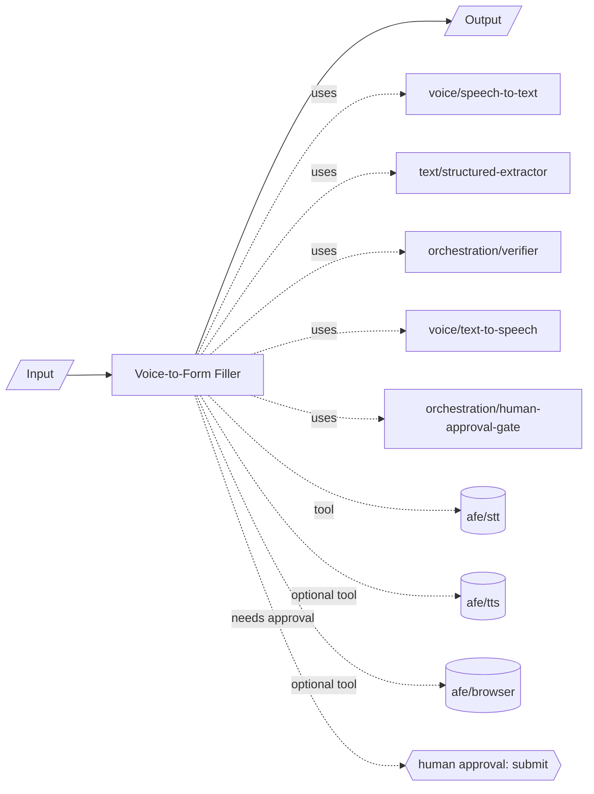

<!-- afe:begin-generated (scripts/build_readmes.py) — edit the manifest, not this block -->

[🏠 Agents for Everything](../../../../README.md) › [📖 Catalog](../../../../CATALOG.md) › [🎙️ Voice and speech](../README.md) › **Voice-to-Form Filler**

# 🎙️ Voice-to-Form Filler

      

> Listens to natural speech, maps answers to typed form fields, checks gaps, and confirms before submit.

Lets users complete structured forms hands-free or in local languages by composing STT, structured extraction, verification, TTS prompts, and an approval gate.

| | |
|---|---|
| **Use it when** | Hands-free or multilingual voice-to-form filling with strict validation. |
| **Don't use it when** | Submitting payments or legal filings without user read-back. |
| **Pattern** | `plan-and-execute` |
| **Modality** | voice, text |
| **Runtime** | interactive · memory: `session` |
| **Languages** | `en`, `hi`, `ta`, `te`, `bn`, `mr`, `es`, `fr` |
| **Tags** | `voice` `voice-form-filler` |

## 🚀 Quick start

```bash
afe add voice/voice-form-filler          # copy this agent (and the agents it uses) into ./agents
afe info voice/voice-form-filler         # manifest, tools, safety level
afe test voice/voice-form-filler         # run its 50 eval cases
```

```python
from agents_for_everything import AgentRunner

payload = {"form": {"id": "dob_form", "fields": [{"id": "dob", "label": "DOB", "type": "date", "required": true}]}, "audio": {"format": "text-simulated", "transcript_hint": "DOB 05 May 1995"}}  # from evals/cases.jsonl
result = AgentRunner().run("voice/voice-form-filler", payload)
print(result.output)
```

> No `afe` command yet? See [Install the CLI](../../../../README.md#-quick-start).

## 🧩 How it works



1. The input is validated against [`input.schema.json`](schemas/input.schema.json).
2. The runtime enforces safety level **S2** and allows only the tools declared in [`tools.yaml`](tools.yaml).
3. The agent follows its [system prompt](prompts/system.md) using the `plan-and-execute` pattern, calling the agents it composes.
4. The output is validated against [`output.schema.json`](schemas/output.schema.json) before it is returned.

## 📥 Input

| Field | Type | Required | Notes |
|---|---|:---:|---|
| `form` | [`FormSchema`](../../../../spec/types/FormSchema.schema.json) | ✅ |  |
| `audio` | [`AudioSource`](../../../../spec/types/AudioSource.schema.json) | ✅ |  |
| `locale` | `string` |  | default `"en-IN"` |
| `prefill` | `object` |  |  |
| `confirm_submit` | `boolean` |  | default `false` |

## 📤 Output

| Field | Type | Required | Notes |
|---|---|:---:|---|
| `values` | `object` | ✅ |  |
| `confidence` | `object` |  |  |
| `missing` | array of `string` | ✅ |  |
| `invalid` | array of [`ValidationError`](../../../../spec/types/ValidationError.schema.json) |  |  |
| `status` | enum | ✅ | one of `complete`, `needs_input`, `awaiting_confirmation`, `submitted` |
| `prompt_back` | `string` |  |  |
| `transcript` | [`Transcript`](../../../../spec/types/Transcript.schema.json) |  |  |

## 🔗 Composes with

- **Uses:** [`voice/speech-to-text`](../speech-to-text/README.md), [`text/structured-extractor`](../../../information/text/structured-extractor/README.md), [`orchestration/verifier`](../../../core/orchestration/verifier/README.md), [`voice/text-to-speech`](../text-to-speech/README.md), [`orchestration/human-approval-gate`](../../../core/orchestration/human-approval-gate/README.md)
- **Used by agents:** [`banking/loan-application-assistant`](../../../industries/banking/loan-application-assistant/README.md), [`government/gov-form-assistant`](../../../industries/government/gov-form-assistant/README.md), [`government/tender-analyzer`](../../../industries/government/tender-analyzer/README.md), [`healthcare/patient-intake`](../../../industries/healthcare/patient-intake/README.md), [`insurance/claims-intake`](../../../industries/insurance/claims-intake/README.md), [`manufacturing/ehs-incident-agent`](../../../industries/manufacturing/ehs-incident-agent/README.md)
- **In recipes:** [`accessible-web`](../../../../recipes/accessible-web/README.md), [`voice-form-filling`](../../../../recipes/voice-form-filling/README.md)

## 🧰 Tools (MCP servers)

| Server | Required | What it provides |
|---|:---:|---|
| [`afe/stt`](../../../../mcp-servers/stt/README.md) | ✅ | Streaming and batch speech transcription with multilingual code-switching support. |
| [`afe/tts`](../../../../mcp-servers/tts/README.md) | optional | Natural multilingual text-to-speech synthesis with SSML and pacing controls. |
| [`afe/browser`](../../../../mcp-servers/browser/README.md) | optional | Playwright-based browser navigation, accessibility-tree reading, and safe form filling. |

## 🛡️ Safety and limits

| | |
|---|---|
| **Safety level** | **S2** — Reversible writes: Drafts and local changes with preview, undo and logging |
| **Autonomy** | **L2** — acts with per-action approval |
| **Side effects** | `fills-form-fields` |
| **Needs approval for** | `submit` |
| **Handles personal data** | yes · retention: `none` |
| **Run limits** | 10 steps · 60 s · $0.03 max |

Full policy: [SECURITY.md](../../../../SECURITY.md).

## 📏 Evaluation

- **50 test cases** in [`evals/cases.jsonl`](evals/cases.jsonl), judged with [`evals/rubric.md`](evals/rubric.md).
- **Targets:** pass_rate ≥ 0.9 ([`eval.yaml`](evals/eval.yaml)).
- **Run:** `afe test voice/voice-form-filler`

## 🧠 Model requirements

- **Needs:** `structured_output`
- **Context:** 8,000+ tokens
- **Tested with:** `frontier-large`, `frontier-small`, `open-weights-8b`
- **Exports:** `python`, `typescript`, `mcp-server`, `a2a-card`, `agent-skill`, `subagent`

## ⚠️ Limitations

Offline mock mode uses deterministic domain heuristics; connect a live model provider for open-ended reasoning.

## 📁 Files

| File | Purpose |
|---|---|
| [`agent.yaml`](agent.yaml) | Manifest: the single source of truth |
| [`prompts/system.md`](prompts/system.md) | Instructions the model follows |
| [`schemas/`](schemas/input.schema.json) | Input and output contracts |
| [`tools.yaml`](tools.yaml) | MCP servers and permissions |
| [`evals/`](evals/eval.yaml) | Test cases, rubric, targets |
| `impl/` | Python and TypeScript implementations |
| [`examples/basic.md`](examples/basic.md) | Worked example |
| [`CHANGELOG.md`](CHANGELOG.md) | Version history |

## 🤝 Help improve this agent

Add eval cases (especially non-English and edge cases), a live-model implementation, or a framework adapter. Start with the [contributing guide](../../../../CONTRIBUTING.md), or [open an issue](https://github.com/rupeshbharambe24/agents-for-everything/issues/new?title=%5Bvoice/voice-form-filler%5D%20) about this agent.

<!-- afe:end-generated -->
