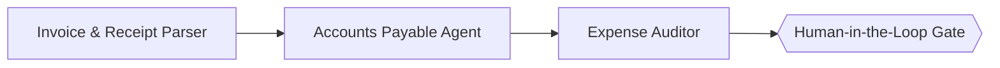

<!-- afe:begin-generated (scripts/build_readmes.py) — edit the manifest, not this block -->

[🏠 Agents for Everything](../../README.md) › [👥 Teams](../../README.md#-ready-made-teams) › **Accounts Payable Team**

# 👥 Accounts Payable Team

    

> Parses vendor invoices, matches against POs, audits expenses, and routes to human finance sign-off.

## 🔀 Workflow



Starts at `documents/invoice-receipt-parser`. Human approval at: `accounts-payable`, `human-approval-gate`.

## 🧑‍🤝‍🧑 Members

| Agent | What it does | Safety |
|---|---|:---:|
| [`documents/invoice-receipt-parser`](../../agents/action/documents/invoice-receipt-parser/README.md) | Extracts vendor, date, line items, GST/VAT tax, and total from invoices and verifies the math. | S1 |
| [`finance/accounts-payable`](../../agents/business/finance/accounts-payable/README.md) | Matches parsed invoices against PO/receipt totals and prepares an approval queue (no autonomous payment). | S4 |
| [`finance/expense-auditor`](../../agents/business/finance/expense-auditor/README.md) | Audits expense claims for duplicate receipts, policy cap breaches, and missing fields. | S1 |
| [`orchestration/human-approval-gate`](../../agents/core/orchestration/human-approval-gate/README.md) | Pauses a workflow before risky steps, displays a clear summary/diff, and records approve/reject decisions. | S1 |

## 🚀 Try it

```bash
afe graph accounts-payable-team   # print the workflow and check that agent contracts fit
for a in documents/invoice-receipt-parser finance/accounts-payable finance/expense-auditor orchestration/human-approval-gate; do afe add $a; done   # copy every member
```

Files: [`team.yaml`](team.yaml) · [`schemas/`](schemas) · [`evals/`](evals)

<!-- afe:end-generated -->
