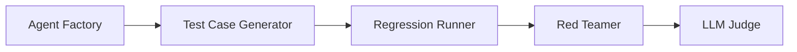

<!-- afe:begin-generated (scripts/build_readmes.py) — edit the manifest, not this block -->

[🏠 Agents for Everything](../../README.md) › [👥 Teams](../../README.md#-ready-made-teams) › **Agent Factory Team**

# 👥 Agent Factory Team

    

> Scaffolds new agents, generates eval suites, runs regressions, red-teams prompts, and grades quality.

## 🔀 Workflow



Starts at `orchestration/agent-builder`.

## 🧑‍🤝‍🧑 Members

| Agent | What it does | Safety |
|---|---|:---:|
| [`orchestration/agent-builder`](../../agents/core/orchestration/agent-builder/README.md) | Generates spec-compliant afe/v1 agent scaffolds from plain-language descriptions. | S2 |
| [`evaluation/test-case-generator`](../../agents/core/evaluation/test-case-generator/README.md) | Synthesizes normal, edge, and adversarial JSONL eval cases from an agent manifest and schemas. | S0 |
| [`evaluation/regression-runner`](../../agents/core/evaluation/regression-runner/README.md) | Runs eval suites across code or prompt edits and compares pass rates against baselines. | S1 |
| [`guardrails/red-teamer`](../../agents/core/guardrails/red-teamer/README.md) | Probes target agents with adversarial prompt-injection and jailbreak test cases. | S1 |
| [`evaluation/llm-judge`](../../agents/core/evaluation/llm-judge/README.md) | Scores outputs against a rubric with calibrated, explained verdicts. | S0 |

## 🚀 Try it

```bash
afe graph agent-factory   # print the workflow and check that agent contracts fit
for a in orchestration/agent-builder evaluation/test-case-generator evaluation/regression-runner guardrails/red-teamer evaluation/llm-judge; do afe add $a; done   # copy every member
```

Files: [`team.yaml`](team.yaml) · [`schemas/`](schemas) · [`evals/`](evals)

<!-- afe:end-generated -->
