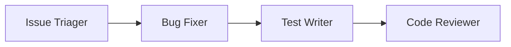

<!-- afe:begin-generated (scripts/build_readmes.py) — edit the manifest, not this block -->

[🏠 Agents for Everything](../../README.md) › [👥 Teams](../../README.md#-ready-made-teams) › **Bug Squash Team**

# 👥 Bug Squash Team

    

> Triages reported issues, isolates root cause, writes fix and regression tests, and reviews the diff.

## 🔀 Workflow



Starts at `coding/issue-triager`. Human approval at: `issue-triager`.

## 🧑‍🤝‍🧑 Members

| Agent | What it does | Safety |
|---|---|:---:|
| [`coding/issue-triager`](../../agents/builders/coding/issue-triager/README.md) | Labels, deduplicates, and prioritizes repository issues and asks for missing repro steps. | S3 |
| [`coding/bug-fixer`](../../agents/builders/coding/bug-fixer/README.md) | Diagnoses bugs from stack traces, proposes a patch, adds regression tests, and verifies review. | S2 |
| [`coding/test-writer`](../../agents/builders/coding/test-writer/README.md) | Generates targeted unit and edge-case tests for functions and APIs. | S2 |
| [`coding/code-reviewer`](../../agents/builders/coding/code-reviewer/README.md) | Reviews code diffs for bugs, security risks, bare excepts, and maintainability issues. | S1 |

## 🚀 Try it

```bash
afe graph bug-squash   # print the workflow and check that agent contracts fit
for a in coding/issue-triager coding/bug-fixer coding/test-writer coding/code-reviewer; do afe add $a; done   # copy every member
```

Files: [`team.yaml`](team.yaml) · [`schemas/`](schemas) · [`evals/`](evals)

<!-- afe:end-generated -->
