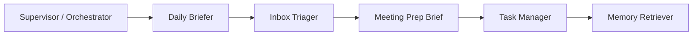

<!-- afe:begin-generated (scripts/build_readmes.py) — edit the manifest, not this block -->

[🏠 Agents for Everything](../../README.md) › [👥 Teams](../../README.md#-ready-made-teams) › **Chief of Staff Team**

# 👥 Chief of Staff Team

    

> Coordinates daily briefing, inbox triage, meeting prep, task planning, and memory recall.

## 🔀 Workflow



Starts at `orchestration/supervisor`.

## 🧑‍🤝‍🧑 Members

| Agent | What it does | Safety |
|---|---|:---:|
| [`orchestration/supervisor`](../../agents/core/orchestration/supervisor/README.md) | Executes a plan by delegating steps to worker agents, tracks state, and re-plans when a step fails. | S1 |
| [`productivity/daily-briefer`](../../agents/life/productivity/daily-briefer/README.md) | Assembles a morning brief from calendar events, top tasks, urgent mail, and weather. | S1 |
| [`communication/inbox-triager`](../../agents/business/communication/inbox-triager/README.md) | Sorts, prioritizes, and labels emails; surfaces urgent threads and reply-needed items. | S1 |
| [`meetings/meeting-prep`](../../agents/business/meetings/meeting-prep/README.md) | Compiles pre-meeting briefs on attendees, prior threads, open items, and suggested agenda. | S1 |
| [`productivity/task-manager`](../../agents/life/productivity/task-manager/README.md) | Captures tasks from notes, chat, or voice, prioritizes them, and structures a daily plan. | S2 |
| [`memory/memory-retriever`](../../agents/core/memory/memory-retriever/README.md) | Recalls relevant memories for the current task, ranked and deduplicated. | S1 |

## 🚀 Try it

```bash
afe graph chief-of-staff   # print the workflow and check that agent contracts fit
for a in orchestration/supervisor productivity/daily-briefer communication/inbox-triager meetings/meeting-prep productivity/task-manager memory/memory-retriever; do afe add $a; done   # copy every member
```

Files: [`team.yaml`](team.yaml) · [`schemas/`](schemas) · [`evals/`](evals)

<!-- afe:end-generated -->
