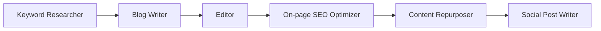

<!-- afe:begin-generated (scripts/build_readmes.py) — edit the manifest, not this block -->

[🏠 Agents for Everything](../../README.md) › [👥 Teams](../../README.md#-ready-made-teams) › **Content Studio Team**

# 👥 Content Studio Team

    

> Turns a target topic into keyword-researched, edited, SEO-checked, multi-channel content.

## 🔀 Workflow



Starts at `marketing/keyword-researcher`.

## 🧑‍🤝‍🧑 Members

| Agent | What it does | Safety |
|---|---|:---:|
| [`marketing/keyword-researcher`](../../agents/business/marketing/keyword-researcher/README.md) | Clusters target keywords by search intent, relevance, and content opportunity. | S1 |
| [`content/blog-writer`](../../agents/business/content/blog-writer/README.md) | Researches, outlines, and drafts source-backed articles tuned for readability. | S1 |
| [`content/editor`](../../agents/business/content/editor/README.md) | Performs structural and clarity editing with tracked suggestions and rationale. | S0 |
| [`content/seo-optimizer`](../../agents/business/content/seo-optimizer/README.md) | Improves headings, keyword coverage, metadata, and internal linking structure. | S0 |
| [`content/content-repurposer`](../../agents/business/content/content-repurposer/README.md) | Transforms one source asset into blog posts, newsletter snippets, and social threads. | S0 |
| [`content/social-post-writer`](../../agents/business/content/social-post-writer/README.md) | Adapts topics or articles into platform-ready posts and threads. | S0 |

## 🚀 Try it

```bash
afe graph content-studio   # print the workflow and check that agent contracts fit
for a in marketing/keyword-researcher content/blog-writer content/editor content/seo-optimizer content/content-repurposer content/social-post-writer; do afe add $a; done   # copy every member
```

Files: [`team.yaml`](team.yaml) · [`schemas/`](schemas) · [`evals/`](evals)

<!-- afe:end-generated -->
