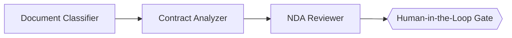

<!-- afe:begin-generated (scripts/build_readmes.py) — edit the manifest, not this block -->

[🏠 Agents for Everything](../../README.md) › [👥 Teams](../../README.md#-ready-made-teams) › **Contract Desk Team**

# 👥 Contract Desk Team

    

> Classifies incoming legal agreements, analyzes clauses, reviews NDAs, and escalates to human counsel.

## 🔀 Workflow



Starts at `documents/doc-classifier`. Human approval at: `human-approval-gate`.

## 🧑‍🤝‍🧑 Members

| Agent | What it does | Safety |
|---|---|:---:|
| [`documents/doc-classifier`](../../agents/action/documents/doc-classifier/README.md) | Identifies document type (invoice, contract, ID, bank statement, resume) for routing. | S1 |
| [`legal/contract-analyzer`](../../agents/business/legal/contract-analyzer/README.md) | Extracts key clauses (indemnity, auto-renewal, IP, liability cap) and flags deviations from a playbook. | S1 |
| [`legal/nda-reviewer`](../../agents/business/legal/nda-reviewer/README.md) | Triages incoming NDAs against standard mutual confidentiality playbooks (accept/redline/escalate). | S1 |
| [`orchestration/human-approval-gate`](../../agents/core/orchestration/human-approval-gate/README.md) | Pauses a workflow before risky steps, displays a clear summary/diff, and records approve/reject decisions. | S1 |

## 🚀 Try it

```bash
afe graph contract-desk   # print the workflow and check that agent contracts fit
for a in documents/doc-classifier legal/contract-analyzer legal/nda-reviewer orchestration/human-approval-gate; do afe add $a; done   # copy every member
```

Files: [`team.yaml`](team.yaml) · [`schemas/`](schemas) · [`evals/`](evals)

<!-- afe:end-generated -->
