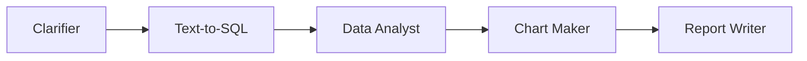

<!-- afe:begin-generated (scripts/build_readmes.py) — edit the manifest, not this block -->

[🏠 Agents for Everything](../../README.md) › [👥 Teams](../../README.md#-ready-made-teams) › **Data Insights Team**

# 👥 Data Insights Team

    

> Clarifies a business question, writes read-only SQL, analyzes results, specs a chart, and reports.

## 🔀 Workflow



Starts at `orchestration/clarifier`.

## 🧑‍🤝‍🧑 Members

| Agent | What it does | Safety |
|---|---|:---:|
| [`orchestration/clarifier`](../../agents/core/orchestration/clarifier/README.md) | Detects ambiguous or under-specified requests and asks the fewest clarifying questions. | S0 |
| [`data/text-to-sql`](../../agents/builders/data/text-to-sql/README.md) | Converts natural-language questions into safe read-only SELECT queries against a schema. | S1 |
| [`data/data-analyst`](../../agents/builders/data/data-analyst/README.md) | Cleans datasets, computes descriptive statistics, and drafts plain-language insights. | S1 |
| [`data/chart-maker`](../../agents/builders/data/chart-maker/README.md) | Selects appropriate chart encodings and emits Vega-Lite/chart specs with captions. | S0 |
| [`research/report-writer`](../../agents/information/research/report-writer/README.md) | Turns research findings into structured Markdown reports with executive summaries and references. | S0 |

## 🚀 Try it

```bash
afe graph data-insights   # print the workflow and check that agent contracts fit
for a in orchestration/clarifier data/text-to-sql data/data-analyst data/chart-maker research/report-writer; do afe add $a; done   # copy every member
```

Files: [`team.yaml`](team.yaml) · [`schemas/`](schemas) · [`evals/`](evals)

<!-- afe:end-generated -->
