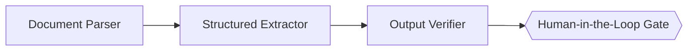

<!-- afe:begin-generated (scripts/build_readmes.py) — edit the manifest, not this block -->

[🏠 Agents for Everything](../../README.md) › [👥 Teams](../../README.md#-ready-made-teams) › **Document Intake Team**

# 👥 Document Intake Team

    

> Turns incoming raw documents into validated, human-approved structured records.

## 🔀 Workflow



Starts at `documents/document-parser`. Human approval at: `human-approval-gate`.

## 🧑‍🤝‍🧑 Members

| Agent | What it does | Safety |
|---|---|:---:|
| [`documents/document-parser`](../../agents/action/documents/document-parser/README.md) | Converts rich documents and scans into clean Markdown with preserved headings and sections. | S1 |
| [`text/structured-extractor`](../../agents/information/text/structured-extractor/README.md) | Turns unstructured text or speech transcripts into normalized JSON matching a target schema. | S0 |
| [`orchestration/verifier`](../../agents/core/orchestration/verifier/README.md) | Checks outputs against required fields, formats, regex rules, and cross-field constraints. | S0 |
| [`orchestration/human-approval-gate`](../../agents/core/orchestration/human-approval-gate/README.md) | Pauses a workflow before risky steps, displays a clear summary/diff, and records approve/reject decisions. | S1 |

## 🚀 Try it

```bash
afe graph document-intake   # print the workflow and check that agent contracts fit
for a in documents/document-parser text/structured-extractor orchestration/verifier orchestration/human-approval-gate; do afe add $a; done   # copy every member
```

Files: [`team.yaml`](team.yaml) · [`schemas/`](schemas) · [`evals/`](evals)

<!-- afe:end-generated -->
