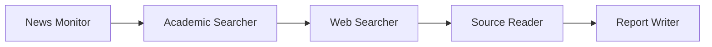

<!-- afe:begin-generated (scripts/build_readmes.py) — edit the manifest, not this block -->

[🏠 Agents for Everything](../../README.md) › [👥 Teams](../../README.md#-ready-made-teams) › **Ecosystem Radar Team**

# 👥 Ecosystem Radar Team

    

> Tracks protocol/paper/web updates, reads primary notes, and compiles the monthly ecosystem radar digest.

## 🔀 Workflow



Starts at `search/news-monitor`.

## 🧑‍🤝‍🧑 Members

| Agent | What it does | Safety |
|---|---|:---:|
| [`search/news-monitor`](../../agents/information/search/news-monitor/README.md) | Tracks watchlist topics across news wires and compiles change alerts. | S1 |
| [`search/academic-search`](../../agents/information/search/academic-search/README.md) | Queries arXiv, PubMed, Semantic Scholar, and OpenAlex for papers and citations. | S1 |
| [`search/web-search`](../../agents/information/search/web-search/README.md) | Runs queries on search APIs, deduplicates URLs, and ranks results with snippets. | S1 |
| [`research/source-reader`](../../agents/information/research/source-reader/README.md) | Reads one URL or document deeply and extracts key points, facts, and quotes. | S1 |
| [`research/report-writer`](../../agents/information/research/report-writer/README.md) | Turns research findings into structured Markdown reports with executive summaries and references. | S0 |

## 🚀 Try it

```bash
afe graph ecosystem-radar   # print the workflow and check that agent contracts fit
for a in search/news-monitor search/academic-search search/web-search research/source-reader research/report-writer; do afe add $a; done   # copy every member
```

Files: [`team.yaml`](team.yaml) · [`schemas/`](schemas) · [`evals/`](evals)

<!-- afe:end-generated -->
