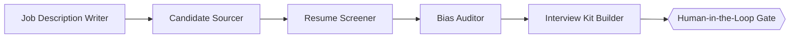

<!-- afe:begin-generated (scripts/build_readmes.py) — edit the manifest, not this block -->

[🏠 Agents for Everything](../../README.md) › [👥 Teams](../../README.md#-ready-made-teams) › **Hiring Pipeline**

# 👥 Hiring Pipeline

    

> Role specification to shortlisted candidates with bias auditing, interview kits, and mandatory human hiring decision gates.

## 🔀 Workflow



Starts at `hr/jd-writer`. Human approval at: `resume-screener`, `human-approval-gate`.

## 🧑‍🤝‍🧑 Members

| Agent | What it does | Safety |
|---|---|:---:|
| [`hr/jd-writer`](../../agents/business/hr/jd-writer/README.md) | Writes clear, structured, inclusive job descriptions from role requirements. | S0 |
| [`hr/candidate-sourcer`](../../agents/business/hr/candidate-sourcer/README.md) | Finds candidates from public professional sources and drafts outreach. | S1 |
| [`hr/resume-screener`](../../agents/business/hr/resume-screener/README.md) | Scores candidate summaries transparently against explicit rubric criteria for human review. | S4 |
| [`guardrails/bias-auditor`](../../agents/core/guardrails/bias-auditor/README.md) | Tests outputs for unequal treatment using counterfactual inputs (swap names, gender, region). | S0 |
| [`hr/interview-kit-builder`](../../agents/business/hr/interview-kit-builder/README.md) | Structured interview questions and scorecards for a role. | S0 |
| [`orchestration/human-approval-gate`](../../agents/core/orchestration/human-approval-gate/README.md) | Pauses a workflow before risky steps, displays a clear summary/diff, and records approve/reject decisions. | S1 |

## 🚀 Try it

```bash
afe graph hiring-pipeline   # print the workflow and check that agent contracts fit
for a in hr/jd-writer hr/candidate-sourcer hr/resume-screener guardrails/bias-auditor hr/interview-kit-builder orchestration/human-approval-gate; do afe add $a; done   # copy every member
```

Files: [`team.yaml`](team.yaml) · [`schemas/`](schemas) · [`evals/`](evals)

<!-- afe:end-generated -->

> **Policy Notice:** Autonomous hiring or candidate rejection without human decision-makers is strictly prohibited ([`SECURITY.md`](../../SECURITY.md)).
