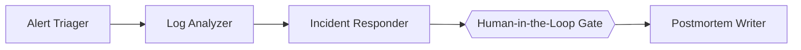

<!-- afe:begin-generated (scripts/build_readmes.py) — edit the manifest, not this block -->

[🏠 Agents for Everything](../../README.md) › [👥 Teams](../../README.md#-ready-made-teams) › **Incident War Room Team**

# 👥 Incident War Room Team

    

> Triages alerts, correlates logs, prepares runbook mitigations behind approval, and drafts postmortem.

## 🔀 Workflow



Starts at `devops/alert-triager`. Human approval at: `incident-responder`, `human-approval-gate`.

## 🧑‍🤝‍🧑 Members

| Agent | What it does | Safety |
|---|---|:---:|
| [`devops/alert-triager`](../../agents/builders/devops/alert-triager/README.md) | Deduplicates and prioritizes noisy alerts by blast radius and SLO burn. | S1 |
| [`devops/log-analyzer`](../../agents/builders/devops/log-analyzer/README.md) | Clusters errors and warnings in application logs and highlights root causes. | S1 |
| [`devops/incident-responder`](../../agents/builders/devops/incident-responder/README.md) | Correlates alerts, metrics, and recent deploys; suggests mitigations and runs approved runbooks. | S3 |
| [`orchestration/human-approval-gate`](../../agents/core/orchestration/human-approval-gate/README.md) | Pauses a workflow before risky steps, displays a clear summary/diff, and records approve/reject decisions. | S1 |
| [`devops/postmortem-writer`](../../agents/builders/devops/postmortem-writer/README.md) | Drafts blameless incident postmortems with timelines, root causes, and preventive tasks. | S1 |

## 🚀 Try it

```bash
afe graph incident-war-room   # print the workflow and check that agent contracts fit
for a in devops/alert-triager devops/log-analyzer devops/incident-responder orchestration/human-approval-gate devops/postmortem-writer; do afe add $a; done   # copy every member
```

Files: [`team.yaml`](team.yaml) · [`schemas/`](schemas) · [`evals/`](evals)

<!-- afe:end-generated -->
