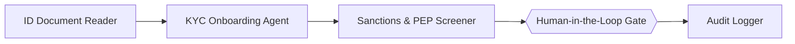

<!-- afe:begin-generated (scripts/build_readmes.py) — edit the manifest, not this block -->

[🏠 Agents for Everything](../../README.md) › [👥 Teams](../../README.md#-ready-made-teams) › **KYC Onboarding Pipeline**

# 👥 KYC Onboarding Pipeline

    

> Consented ID extraction, KYC checks, sanctions/PEP screening, officer approval, and audit logging.

## 🔀 Workflow



Starts at `vision/id-document-reader`. Human approval at: `id-document-reader`, `kyc-onboarding`, `sanctions-screener`, `human-approval-gate`.

## 🧑‍🤝‍🧑 Members

| Agent | What it does | Safety |
|---|---|:---:|
| [`vision/id-document-reader`](../../agents/perception/vision/id-document-reader/README.md) | Extracts identity card fields for consented KYC workflows with quality checks. | S4 |
| [`banking/kyc-onboarding`](../../agents/industries/banking/kyc-onboarding/README.md) | Extracts and cross-checks KYC applicant records and flags mismatches for a human compliance officer. | S4 |
| [`banking/sanctions-screener`](../../agents/industries/banking/sanctions-screener/README.md) | Transliteration-aware fuzzy name screening against sanctions/PEP lists with explained matches for officer review. | S4 |
| [`orchestration/human-approval-gate`](../../agents/core/orchestration/human-approval-gate/README.md) | Pauses a workflow before risky steps, displays a clear summary/diff, and records approve/reject decisions. | S1 |
| [`guardrails/audit-logger`](../../agents/core/guardrails/audit-logger/README.md) | Records structured, PII-safe audit trail entries for agent actions and approvals. | S2 |

## 🚀 Try it

```bash
afe graph kyc-pipeline   # print the workflow and check that agent contracts fit
for a in vision/id-document-reader banking/kyc-onboarding banking/sanctions-screener orchestration/human-approval-gate guardrails/audit-logger; do afe add $a; done   # copy every member
```

Files: [`team.yaml`](team.yaml) · [`schemas/`](schemas) · [`evals/`](evals)

<!-- afe:end-generated -->
