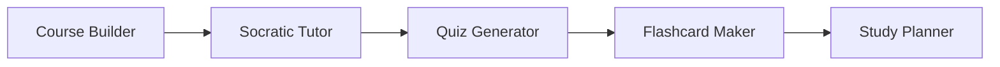

<!-- afe:begin-generated (scripts/build_readmes.py) — edit the manifest, not this block -->

[🏠 Agents for Everything](../../README.md) › [👥 Teams](../../README.md#-ready-made-teams) › **Personalized Learning Coach**

# 👥 Personalized Learning Coach

    

> Personalized learning programme combining syllabus design, Socratic tutoring, quizzes, flashcards, and study scheduling.

## 🔀 Workflow



Starts at `education/course-builder`.

## 🧑‍🤝‍🧑 Members

| Agent | What it does | Safety |
|---|---|:---:|
| [`education/course-builder`](../../agents/life/education/course-builder/README.md) | Builds a course: modules, lessons, assessments, resources. | S0 |
| [`education/tutor`](../../agents/life/education/tutor/README.md) | Guides learners with progressive Socratic questions and hints without spoiling final answers. | S1 |
| [`education/quiz-generator`](../../agents/life/education/quiz-generator/README.md) | Builds diagnostic multiple-choice and short-answer quizzes with answer keys from study material. | S0 |
| [`education/flashcard-maker`](../../agents/life/education/flashcard-maker/README.md) | Extracts atomic concepts into Anki-ready spaced-repetition question/answer flashcards. | S0 |
| [`education/study-planner`](../../agents/life/education/study-planner/README.md) | Exam-oriented study schedule with spaced revision. | S1 |

## 🚀 Try it

```bash
afe graph learning-coach   # print the workflow and check that agent contracts fit
for a in education/course-builder education/tutor education/quiz-generator education/flashcard-maker education/study-planner; do afe add $a; done   # copy every member
```

Files: [`team.yaml`](team.yaml) · [`schemas/`](schemas) · [`evals/`](evals)

<!-- afe:end-generated -->
