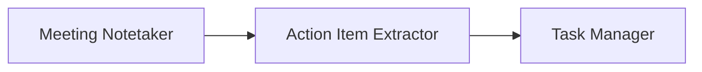

<!-- afe:begin-generated (scripts/build_readmes.py) — edit the manifest, not this block -->

[🏠 Agents for Everything](../../README.md) › [👥 Teams](../../README.md#-ready-made-teams) › **Meeting-to-Done Team**

# 👥 Meeting-to-Done Team

    

> Converts meeting audio into structured notes, extracted action items, and prioritized tasks.

## 🔀 Workflow



Starts at `meetings/meeting-notetaker`.

## 🧑‍🤝‍🧑 Members

| Agent | What it does | Safety |
|---|---|:---:|
| [`meetings/meeting-notetaker`](../../agents/business/meetings/meeting-notetaker/README.md) | Transcribes meetings and produces structured summaries with decisions and risks. | S1 |
| [`meetings/action-item-extractor`](../../agents/business/meetings/action-item-extractor/README.md) | Pulls concrete tasks with owners and due dates from meeting notes, transcripts, or chats. | S2 |
| [`productivity/task-manager`](../../agents/life/productivity/task-manager/README.md) | Captures tasks from notes, chat, or voice, prioritizes them, and structures a daily plan. | S2 |

## 🚀 Try it

```bash
afe graph meeting-to-done   # print the workflow and check that agent contracts fit
for a in meetings/meeting-notetaker meetings/action-item-extractor productivity/task-manager; do afe add $a; done   # copy every member
```

Files: [`team.yaml`](team.yaml) · [`schemas/`](schemas) · [`evals/`](evals)

<!-- afe:end-generated -->
