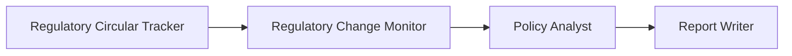

<!-- afe:begin-generated (scripts/build_readmes.py) — edit the manifest, not this block -->

[🏠 Agents for Everything](../../README.md) › [👥 Teams](../../README.md#-ready-made-teams) › **Regulatory Watch & Impact Team**

# 👥 Regulatory Watch & Impact Team

    

> Monitors regulator circulars and policy proposals, assesses compliance impact, and prepares action briefings.

## 🔀 Workflow



Starts at `banking/regulatory-circular-tracker`. Human approval at: `compliance-monitor`.

## 🧑‍🤝‍🧑 Members

| Agent | What it does | Safety |
|---|---|:---:|
| [`banking/regulatory-circular-tracker`](../../agents/industries/banking/regulatory-circular-tracker/README.md) | Tracks central bank circulars and regulatory notices and maps impacted internal processes. | S1 |
| [`legal/compliance-monitor`](../../agents/business/legal/compliance-monitor/README.md) | Tracks regulatory notices across jurisdictions and maps updates to internal obligations. | S1 |
| [`research/policy-analyst`](../../agents/information/research/policy-analyst/README.md) | Analyzes a regulation or policy proposal: who it affects and how. | S1 |
| [`research/report-writer`](../../agents/information/research/report-writer/README.md) | Turns research findings into structured Markdown reports with executive summaries and references. | S0 |

## 🚀 Try it

```bash
afe graph regulatory-watch   # print the workflow and check that agent contracts fit
for a in banking/regulatory-circular-tracker legal/compliance-monitor research/policy-analyst research/report-writer; do afe add $a; done   # copy every member
```

Files: [`team.yaml`](team.yaml) · [`schemas/`](schemas) · [`evals/`](evals)

<!-- afe:end-generated -->
