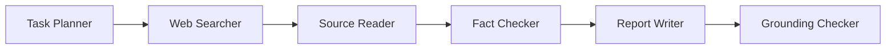

<!-- afe:begin-generated (scripts/build_readmes.py) — edit the manifest, not this block -->

[🏠 Agents for Everything](../../README.md) › [👥 Teams](../../README.md#-ready-made-teams) › **Research Team**

# 👥 Research Team

    

> Produces a cited, grounding-verified research report on any topic.

## 🔀 Workflow



Starts at `orchestration/task-planner`.

## 🧑‍🤝‍🧑 Members

| Agent | What it does | Safety |
|---|---|:---:|
| [`orchestration/task-planner`](../../agents/core/orchestration/task-planner/README.md) | Breaks a goal into ordered, dependency-aware steps with success criteria and estimated cost. | S0 |
| [`search/web-search`](../../agents/information/search/web-search/README.md) | Runs queries on search APIs, deduplicates URLs, and ranks results with snippets. | S1 |
| [`research/source-reader`](../../agents/information/research/source-reader/README.md) | Reads one URL or document deeply and extracts key points, facts, and quotes. | S1 |
| [`research/fact-checker`](../../agents/information/research/fact-checker/README.md) | Verifies discrete claims against web or retrieved sources and outputs verdicts with evidence. | S1 |
| [`research/report-writer`](../../agents/information/research/report-writer/README.md) | Turns research findings into structured Markdown reports with executive summaries and references. | S0 |
| [`guardrails/hallucination-checker`](../../agents/core/guardrails/hallucination-checker/README.md) | Checks each claim in an answer against provided sources and flags unsupported statements. | S0 |

## 🚀 Try it

```bash
afe graph research-team   # print the workflow and check that agent contracts fit
for a in orchestration/task-planner search/web-search research/source-reader research/fact-checker research/report-writer guardrails/hallucination-checker; do afe add $a; done   # copy every member
```

Files: [`team.yaml`](team.yaml) · [`schemas/`](schemas) · [`evals/`](evals)

<!-- afe:end-generated -->
