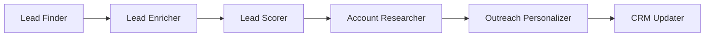

<!-- afe:begin-generated (scripts/build_readmes.py) — edit the manifest, not this block -->

[🏠 Agents for Everything](../../README.md) › [👥 Teams](../../README.md#-ready-made-teams) › **SDR Prospecting Team**

# 👥 SDR Prospecting Team

    

> Finds ICP leads, enriches and scores accounts, drafts tailored outreach, and stages CRM updates.

## 🔀 Workflow



Starts at `sales/lead-finder`. Human approval at: `crm-updater`.

## 🧑‍🤝‍🧑 Members

| Agent | What it does | Safety |
|---|---|:---:|
| [`sales/lead-finder`](../../agents/business/sales/lead-finder/README.md) | Identifies target companies matching an ideal customer profile from public sources. | S1 |
| [`sales/lead-enricher`](../../agents/business/sales/lead-enricher/README.md) | Adds public firmographics, industry, and recent news to lead records. | S1 |
| [`sales/lead-scorer`](../../agents/business/sales/lead-scorer/README.md) | Scores leads transparently by ICP fit and intent signals with reasons. | S1 |
| [`sales/account-researcher`](../../agents/business/sales/account-researcher/README.md) | Builds pre-call briefs summarizing company priorities, leadership, and recent news. | S1 |
| [`sales/outreach-personalizer`](../../agents/business/sales/outreach-personalizer/README.md) | Drafts tailored outreach email sequences grounded in verified account research (draft only). | S2 |
| [`sales/crm-updater`](../../agents/business/sales/crm-updater/README.md) | Extracts call/meeting takeaways into structured CRM field updates gated by approval. | S3 |

## 🚀 Try it

```bash
afe graph sdr-team   # print the workflow and check that agent contracts fit
for a in sales/lead-finder sales/lead-enricher sales/lead-scorer sales/account-researcher sales/outreach-personalizer sales/crm-updater; do afe add $a; done   # copy every member
```

Files: [`team.yaml`](team.yaml) · [`schemas/`](schemas) · [`evals/`](evals)

<!-- afe:end-generated -->
