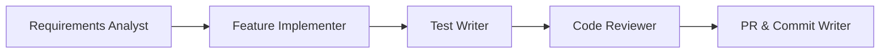

<!-- afe:begin-generated (scripts/build_readmes.py) — edit the manifest, not this block -->

[🏠 Agents for Everything](../../README.md) › [👥 Teams](../../README.md#-ready-made-teams) › **Software Squad**

# 👥 Software Squad

    

> Ships a feature from requirements through code generation, tests, review, and PR description.

## 🔀 Workflow



Starts at `operations/requirements-analyst`.

## 🧑‍🤝‍🧑 Members

| Agent | What it does | Safety |
|---|---|:---:|
| [`operations/requirements-analyst`](../../agents/business/operations/requirements-analyst/README.md) | Transforms stakeholder notes into PRDs, user stories, and testable acceptance criteria. | S0 |
| [`coding/code-generator`](../../agents/builders/coding/code-generator/README.md) | Implements scoped features from a spec and pairs them with unit tests. | S2 |
| [`coding/test-writer`](../../agents/builders/coding/test-writer/README.md) | Generates targeted unit and edge-case tests for functions and APIs. | S2 |
| [`coding/code-reviewer`](../../agents/builders/coding/code-reviewer/README.md) | Reviews code diffs for bugs, security risks, bare excepts, and maintainability issues. | S1 |
| [`coding/pr-describer`](../../agents/builders/coding/pr-describer/README.md) | Generates structured PR summaries, conventional commit messages, and changelog bullets from diffs. | S0 |

## 🚀 Try it

```bash
afe graph software-squad   # print the workflow and check that agent contracts fit
for a in operations/requirements-analyst coding/code-generator coding/test-writer coding/code-reviewer coding/pr-describer; do afe add $a; done   # copy every member
```

Files: [`team.yaml`](team.yaml) · [`schemas/`](schemas) · [`evals/`](evals)

<!-- afe:end-generated -->
