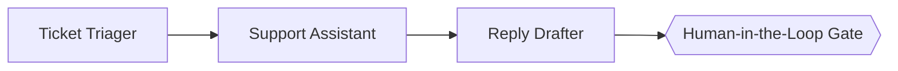

<!-- afe:begin-generated (scripts/build_readmes.py) — edit the manifest, not this block -->

[🏠 Agents for Everything](../../README.md) › [👥 Teams](../../README.md#-ready-made-teams) › **Support Desk Team**

# 👥 Support Desk Team

    

> Triages customer tickets, retrieves KB answers, drafts replies, and gates risky escalations.

## 🔀 Workflow



Starts at `support/ticket-triager`. Human approval at: `human-approval-gate`.

## 🧑‍🤝‍🧑 Members

| Agent | What it does | Safety |
|---|---|:---:|
| [`support/ticket-triager`](../../agents/business/support/ticket-triager/README.md) | Classifies, prioritizes, and routes incoming support tickets cleanly. | S2 |
| [`support/support-chatbot`](../../agents/business/support/support-chatbot/README.md) | Answers customer questions from KB docs with citations and flags handoffs when uncertain. | S1 |
| [`support/reply-drafter`](../../agents/business/support/reply-drafter/README.md) | Drafts KB-grounded support replies for human agents to review and send. | S2 |
| [`orchestration/human-approval-gate`](../../agents/core/orchestration/human-approval-gate/README.md) | Pauses a workflow before risky steps, displays a clear summary/diff, and records approve/reject decisions. | S1 |

## 🚀 Try it

```bash
afe graph support-desk   # print the workflow and check that agent contracts fit
for a in support/ticket-triager support/support-chatbot support/reply-drafter orchestration/human-approval-gate; do afe add $a; done   # copy every member
```

Files: [`team.yaml`](team.yaml) · [`schemas/`](schemas) · [`evals/`](evals)

<!-- afe:end-generated -->
