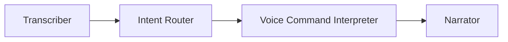

<!-- afe:begin-generated (scripts/build_readmes.py) — edit the manifest, not this block -->

[🏠 Agents for Everything](../../README.md) › [👥 Teams](../../README.md#-ready-made-teams) › **Voice Concierge Team**

# 👥 Voice Concierge Team

    

> Voice in, intent routing and action execution, and spoken response out.

## 🔀 Workflow



Starts at `voice/speech-to-text`.

## 🧑‍🤝‍🧑 Members

| Agent | What it does | Safety |
|---|---|:---:|
| [`voice/speech-to-text`](../../agents/perception/voice/speech-to-text/README.md) | Batch or streaming speech recognition with punctuation, language detection, and code-switching. | S1 |
| [`orchestration/router`](../../agents/core/orchestration/router/README.md) | Classifies a user request and selects the best matching agent or team with extracted arguments. | S0 |
| [`voice/voice-command`](../../agents/perception/voice/voice-command/README.md) | Maps spoken commands to structured app actions or function calls. | S1 |
| [`voice/text-to-speech`](../../agents/perception/voice/text-to-speech/README.md) | Natural speech synthesis from text with locale, speed, and tone control. | S0 |

## 🚀 Try it

```bash
afe graph voice-concierge   # print the workflow and check that agent contracts fit
for a in voice/speech-to-text orchestration/router voice/voice-command voice/text-to-speech; do afe add $a; done   # copy every member
```

Files: [`team.yaml`](team.yaml) · [`schemas/`](schemas) · [`evals/`](evals)

<!-- afe:end-generated -->
