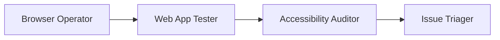

<!-- afe:begin-generated (scripts/build_readmes.py) — edit the manifest, not this block -->

[🏠 Agents for Everything](../../README.md) › [👥 Teams](../../README.md#-ready-made-teams) › **Web QA Team**

# 👥 Web QA Team

    

> Navigates staging web apps, runs E2E tests, audits WCAG accessibility, and drafts issue reports.

## 🔀 Workflow



Starts at `browser/web-navigator`. Human approval at: `web-navigator`, `issue-triager`.

## 🧑‍🤝‍🧑 Members

| Agent | What it does | Safety |
|---|---|:---:|
| [`browser/web-navigator`](../../agents/action/browser/web-navigator/README.md) | Completes multi-step web tasks safely using accessibility trees and screenshots with injection guards. | S3 |
| [`browser/web-tester`](../../agents/action/browser/web-tester/README.md) | Walks through staging web flows, generates Playwright checks, and captures bug reports. | S2 |
| [`accessibility/accessibility-auditor`](../../agents/perception/accessibility/accessibility-auditor/README.md) | Checks HTML/UI attributes against WCAG contrast, alt-text, and landmark rules. | S1 |
| [`coding/issue-triager`](../../agents/builders/coding/issue-triager/README.md) | Labels, deduplicates, and prioritizes repository issues and asks for missing repro steps. | S3 |

## 🚀 Try it

```bash
afe graph web-qa-team   # print the workflow and check that agent contracts fit
for a in browser/web-navigator browser/web-tester accessibility/accessibility-auditor coding/issue-triager; do afe add $a; done   # copy every member
```

Files: [`team.yaml`](team.yaml) · [`schemas/`](schemas) · [`evals/`](evals)

<!-- afe:end-generated -->
